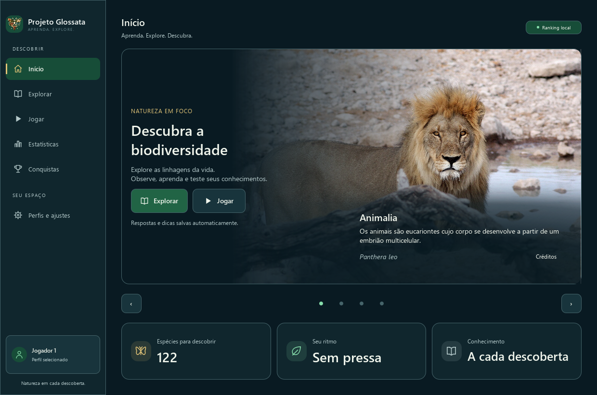
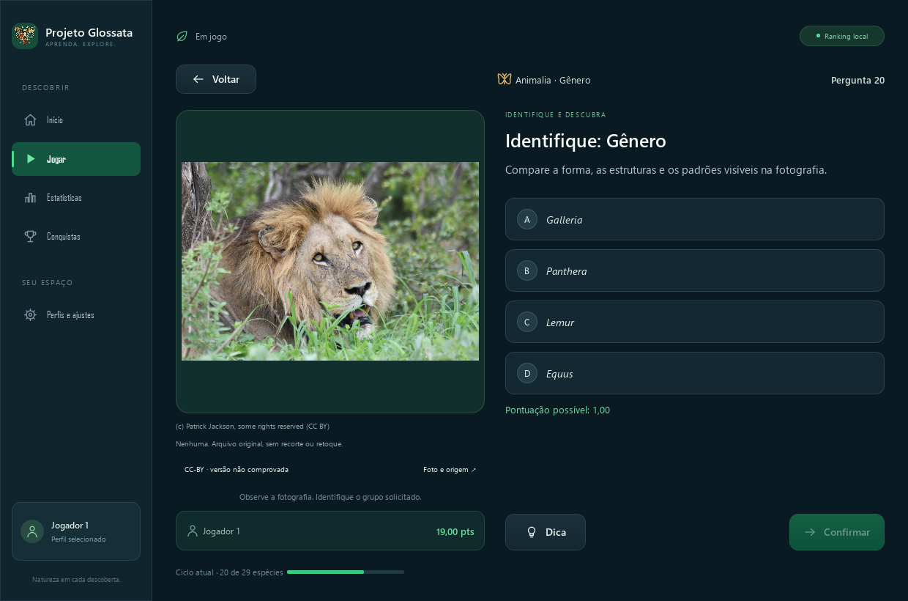
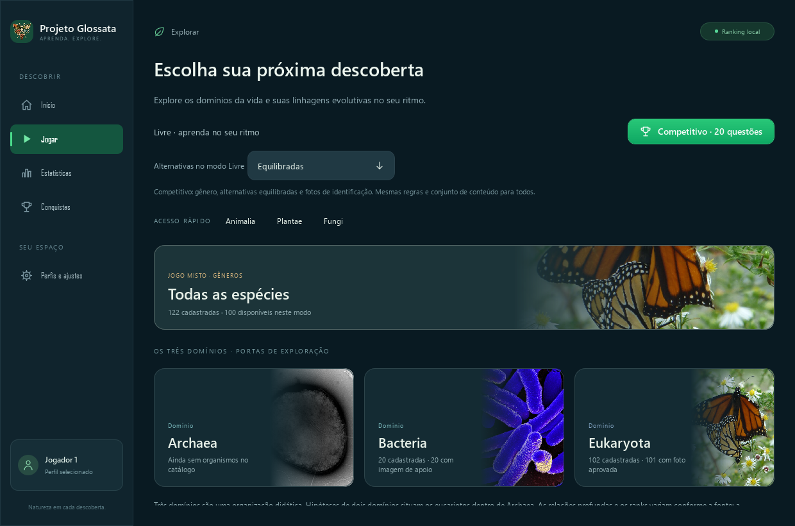

# Projeto Glossata

**Explore a diversidade da vida.**

> **Transparência:** há conteúdo legado sem revisão humana rastreável e permissões de redistribuição ainda incompletas. Testes não certificam conformidade jurídica ou científica. Consulte o [plano e a matriz de ação](docs/CONFORMIDADE.md), os [direitos por camada](docs/DIREITOS_E_LICENCAS.md) e o [canal de correção/remoção](docs/REPORTAR_PROBLEMA.md).

> Uma iniciativa educacional independente, gratuita e sem fins lucrativos, dedicada à divulgação científica e ao aprendizado sobre a biodiversidade.


## Sobre o projeto

O **Projeto Glossata** nasceu como um jogo educativo de identificação de organismos e está evoluindo para uma **plataforma de educação e exploração da natureza**. Seu propósito é reunir informação científica acessível, recursos visuais e atividades interativas para estimular a curiosidade e tornar o estudo da biodiversidade mais envolvente.

O nome *Glossata* faz referência a um clado de lepidópteros que inclui a maioria das borboletas e mariposas — uma homenagem à origem do projeto, **não uma restrição ao conteúdo**. A iniciativa pretende abordar a diversidade da vida em diferentes grupos biológicos, suas características, relações evolutivas e papéis nos ecossistemas.

A aplicação disponível atualmente é o **Projeto Glossata**, um programa desktop em português, com catálogo local de organismos, exploração taxonômica, fichas educativas, desafios de identificação e acompanhamento do desempenho. A visão de longo prazo é integrar esses recursos a uma **enciclopédia interativa da natureza**.



*Captura do aplicativo em execução, com perfil temporário. [Origem da captura](docs/images/tela-inicial.json) · [Como atualizar a captura e preparar lançamentos](docs/VERSIONAMENTO.md).*



*Quiz em execução com perfil temporário. Fotografia: Patrick Jackson, conforme o crédito da fonte; licença declarada [CC BY](https://creativecommons.org/licenses/by/4.0/), com versão ainda não comprovada. [Foto original](https://www.inaturalist.org/photos/748172022) · [Origem da captura e atribuição](docs/images/quiz.json). A proveniência legada da foto mantém as [pendências documentadas](docs/RELATORIO_CONFORMIDADE.md).*

### Missão

Democratizar o acesso ao conhecimento sobre a biodiversidade por meio de ferramentas gratuitas, conteúdo com referências verificáveis e experiências interativas de aprendizagem.

### Princípios

- **Acesso ao conhecimento:** proposta educacional gratuita e sem finalidade lucrativa.
- **Rigor e transparência:** identificação das fontes, das limitações e dos estágios de curadoria.
- **Aprendizagem ativa:** uso de exploração, observação, questões e feedback para consolidar conceitos.
- **Respeito à biodiversidade:** incentivo à compreensão da diversidade biológica e de sua conservação.
- **Evolução contínua:** aperfeiçoamento gradual de dados, recursos e acessibilidade.

## Estado atual

Aplicativo **1.5.0 em desenvolvimento** · Catálogo **2.3.0, ainda não lançado**. Consulte o [CHANGELOG](CHANGELOG.md), o [histórico científico e de licenças](docs/CATALOGO_CHANGELOG.md) e o [procedimento de versionamento](docs/VERSIONAMENTO.md). Os bloqueios de distribuição impedem uma tag/release nesta etapa; nenhuma versão publicada é declarada por estes números.

**Em desenvolvimento.** O produto funcional atual é um aplicativo desktop, **não** uma enciclopédia web completa. Os recursos descritos abaixo correspondem ao estado documentado do repositório em outubro de 2026; a visão futura está separada na seção [Roadmap](#roadmap).

| Recurso | Situação |
| --- | --- |
| Interface desktop com Qt Quick/QML | Implementado |
| Exploração de grupos e níveis taxonômicos | Implementado |
| Quiz com quatro alternativas e feedback | Implementado |
| Modos Livre e Competitivo | Implementado |
| Dicas estratégicas com pontuação proporcional | Implementado |
| Fichas educativas e fontes para organismos do catálogo | Implementado; curadoria em evolução |
| Perfis, histórico local, estatísticas e rankings | Implementado |
| Catálogo e funcionamento offline | Implementado |
| Enciclopédia ampla com pesquisa avançada | Visão futura |
| Trilhas de aprendizagem e atlas interativo | Visão futura |
| Plataforma web e colaboração pública | Possibilidades futuras, sem cronograma definido |

## Biodiversidade e classificação

O catálogo atual utiliza **Bacteria, Archaea e Eukaryota** como portas didáticas para explorar linhagens evolutivas:

| Domínio | Organismos ativos no catálogo |
| --- | ---: |
| Bacteria | 20 |
| Archaea | 0 |
| Eukaryota | 102 |
| **Total** | **122** |

Eukaryota oferece **Opisthokonta** (62 organismos, incluindo Animalia e Fungi), **Archaeplastida** (20, Plantae no sentido da fonte), **SAR** (10, em Stramenopiles), **Amoebozoa** (10) e **Discoba** (ainda sem representantes). Supergrupo designa um clado de navegação sem rank formal universal; domínio, reino e os demais níveis permanecem distintos. Grupos vazios continuam exploráveis e não geram quizzes.

> **Nota científica:** três domínios são uma organização didática; hipóteses de dois domínios situam os eucariotos dentro de Archaea. A navegação omite ramos intermediários e não representa uma filogenia completa ou definitivamente resolvida. Monera e Protista ficam apenas nas referências históricas e na compatibilidade dos dados. O enquadramento consulta Adl et al. (2019), Burki et al. (2020) e estudos de Asgard de 2025–2026, com divergências e fontes registradas na [documentação científica e de migração](docs/CLASSIFICACAO_FILOGENETICA.md).

Os **122 enquadramentos novos permanecem rascunhos assistidos por IA**, sem simular revisão por especialista. A classificação original do iNaturalist está preservada por organismo e tem revisão separada da síntese filogenética. [Auditoria dos 122 registros](docs/AUDITORIA_FILOGENETICA.json).

## Funcionalidades implementadas

### Rede de provedores científicos

Ferramentas de manutenção integram **GBIF, Catalogue of Life, WoRMS e Wikimedia Commons**, com contratos independentes, cache offline, reconciliação de nomes/sinônimos, prevenção de duplicatas por identidade externa e registro de divergências. A descoberta prioriza linhagens pouco representadas. As consultas produzem candidatos em banco separado, com revisão científica e jurídica pendente; não alteram automaticamente os 122 organismos ou o jogo.

NCBI Taxonomy, LPSN, POWO e MycoBank têm etapas e restrições documentadas para integração futura. A [arquitetura, condições de acesso e procedimentos](docs/PROVEDORES_CIENTIFICOS.md) distinguem provedores implementados de planejados; os [recibos de consultas reais e replay offline](docs/VALIDACAO_PROVEDORES.json) não são aprovação científica ou jurídica.

### Exploração taxonômica

Navegação por domínios, linhagens, grupos e subgrupos, com caminhos clicáveis, fontes, limitações e níveis de identificação disponíveis conforme a cobertura do catálogo. Ranks ausentes não são inferidos. Animalia, Plantae e Fungi têm acesso rápido, preservando seus caminhos em Opisthokonta ou Archaeplastida. Os controles de quiz mantêm a posição anterior à expansão fotográfica; os grupos filhos aparecem depois dos controles. Os cartões integram fotografias reais e micrografias identificadas ao fundo, em 42% da largura e toda a altura, com recorte proporcional e gradiente horizontal. A auditoria cobre os 623 cartões: 534 com associação fotográfica e 89 com pendência justificada, usando 109 imagens offline; grupos sem foto adequada conservam a ilustração. Autoria, origem, licenças por arquivo e limites estão nos [créditos](docs/PHOTO_CREDITS.md) e na [documentação da exploração](docs/EXPLORACAO_E_FOTOGRAFIAS.md). Os níveis de quiz exigem revisão adequada, aprovação fotográfica no nível e quatro alternativas distintas. Domínio, supergrupo e reino estão sem quiz elegível nesta etapa; os demais níveis disponíveis continuam funcionando.



[Créditos das fotografias](docs/PHOTO_CREDITS.md) · [Registro da captura real](docs/images/exploracao.json).

### Projeto Glossata

Cada questão apresenta quatro alternativas de identificação no mesmo nível taxonômico, seleção, confirmação e feedback. A fotografia e os dados utilizados na resposta são preservados para a etapa de revisão.

- **Modo Livre:** exploração contínua, com filtros e diferentes políticas de alternativas; a partida termina quando o jogador decide encerrá-la.
- **Modo Competitivo:** 20 questões em condições padronizadas, sem repetição de organismos na mesma partida, com regras de elegibilidade e ranking específicas.

### Dicas estratégicas e pontuação

O quiz busca três dicas progressivas — leve, moderada e forte — conforme as fontes, o nível e as alternativas. A categoria é independente da posição:

| Categoria | Assunto |
| --- | ---: |
| Taxonômica | Contexto da classificação |
| Etimológica | Origem do nome |
| Morfológica | Aspectos físicos |

A **assistência daquela dica e questão**, avaliada separadamente da categoria, define o teto:

| Assistência | Unidades | Teto do acerto |
| --- | ---: | ---: |
| Leve | 6 | 1 ponto |
| Moderada | 3 | 0,5 ponto |
| Forte | 2 | 1/3 de ponto |

Abrir o painel de dicas não reduz a pontuação. Quando mais de uma dica é revelada, vale o **menor teto**; a interface anuncia o teto resultante antes de revelar. Uma tradução reconhecível pode oferecer assistência forte, enquanto uma descrição já evidente na foto pode oferecer assistência leve. O cálculo permanece em unidades inteiras e acertos/precisão são independentes dos pontos.

A versão de testes usa **avaliação pedagógica automatizada** (`approved_automated`, política `progressive-pedagogy-v1`), identificada na interface e independente da revisão científica. As 290 propostas anteriores são preservadas como rascunhos. Receitas locais para os 122 organismos reutilizam fontes existentes; o contexto determina quais dicas podem aparecer. Não se inventa uma terceira dica quando falta evidência. Categorias podem repetir com conteúdo distinto, mantendo escolha direta de qualquer dica e o menor teto. Consulte a [política e os limites](docs/DICAS_E_PONTUACAO.md), a [auditoria das avaliações](docs/AUDITORIA_ASSISTENCIA.json) e a [cobertura e lacunas](docs/AUDITORIA_PROGRESSAO_DICAS.json). **Relatar problema nesta dica** prepara um rascunho local; somente uma ação explícita abre o formulário externo. Respostas antigas conservam os pontos; novas partidas competitivas usam `identification-v4-progressive`, separada das políticas anteriores internamente no mesmo ranking.

### Fichas educativas

Os 122 organismos ativos têm fichas em português com informações como apresentação, características morfológicas, distribuição ou ocorrência documentada, conservação e curiosidades; informações sobre alimentação ou nutrição aparecem quando documentadas. As fichas disponibilizam classificação e referências, com cobertura e revisão ainda em evolução.

### Imagens e proveniência

O catálogo possui 122 registros ativos e 120 arquivos distintos de imagem. Existe validação técnica de arquivos, fonte, créditos, licença, identidade e integridade. **Nem toda imagem é evidência suficiente para identificar uma espécie:** as imagens de apoio dos 20 registros bacterianos são sinalizadas como tal, e a elegibilidade visual varia conforme o nível taxonômico e a revisão.

### Progresso e perfis

- Perfis locais de jogadores, com criação, renomeação, seleção e exclusão sob regras de integridade.
- Histórico de respostas e partidas, métricas de precisão e uso de dicas.
- Rankings locais com distinção entre recorde e última partida.
- Conquistas e estatísticas associadas à experiência disponível.
- Persistência em SQLite e possibilidade de usar o aplicativo sem internet após a preparação dos recursos.

### Discord (opcional)

Integração local com o Discord Rich Presence, configurável e desativável, sem exigir conexão para as funções principais do jogo.

## Tecnologias

| Camada | Tecnologias |
| --- | --- |
| Linguagem principal | C++17 |
| Interface | Qt 6 Quick / QML |
| Persistência | SQLite / Qt SQL |
| Compilação | CMake, Ninja, GCC via MSYS2 UCRT64 |
| Importação e auditoria de dados | Python 3.11+ |
| Testes | CTest, Qt Test e testes auxiliares em Python |
| Dados e recursos | JSON, imagens e recursos incorporados ao aplicativo |

### Organização do repositório

```text
Projeto-Glossata/
├── docs/                 # Documentação técnica, científica e de curadoria
├── package/              # Recursos e scripts de distribuição para Windows
├── resources/            # Dados, imagens, QML e elementos visuais
├── scripts/              # Importação, auditoria e empacotamento
├── src/                  # Código-fonte C++
├── tests/                # Testes automatizados
├── CMakeLists.txt        # Configuração da compilação
├── resources.qrc         # Manifesto de recursos Qt
├── PROJECT_CONTEXT.md    # Contexto e decisões técnicas do projeto
└── README.md
```

A arquitetura separa regras de domínio, serviços de aplicação, interfaces de persistência, adaptadores de infraestrutura e apresentação QML. O catálogo e o histórico são mantidos localmente, e o acesso a fontes externas é concentrado nos processos de preparação e atualização dos dados.

## Compilação e testes no Windows

### Pré-requisitos

- Windows;
- **MSYS2 UCRT64** com compilador C++ compatível com C++17;
- **CMake** e **Ninja**;
- **Qt 6** com os componentes Core, Gui, Quick, Sql, Network e Test;
- **Python 3.11+** para os scripts auxiliares.

Garanta que o terminal utilizado tenha acesso aos executáveis e bibliotecas instalados no ambiente UCRT64.

### Clonar e compilar

```bash
git clone https://github.com/kaduolliver/Projeto-Glossata.git
cd Projeto-Glossata
cmake -S . -B build -G Ninja -DCMAKE_BUILD_TYPE=Release
cmake --build build --parallel 4
```

### Executar os testes

```bash
ctest --test-dir build --output-on-failure
```

Para verificar arquivos QML no PowerShell, com `qmllint` disponível no PATH:

```powershell
$qmlFiles = @(Get-ChildItem resources/qml -Recurse -Filter '*.qml' | ForEach-Object { $_.FullName })
qmllint @qmlFiles --unqualified disable
```

### Empacotar para Windows

No PowerShell, após compilar:

```powershell
powershell -ExecutionPolicy Bypass -File scripts/package.ps1
```

O processo prepara os componentes Qt e as dependências de execução para o pacote local. **O repositório não inclui executáveis e bibliotecas geradas:** um clone novo precisa ser compilado. A validação em uma instalação Windows completamente limpa ainda é um ponto a verificar.

Esse comando é o fluxo de distribuição e falha enquanto houver permissões ou obrigações não demonstradas. Para testar localmente, use `powershell -ExecutionPolicy Bypass -File scripts/package.ps1 -Development`; o pacote fica identificado como desenvolvimento local e inclui créditos, evidências e pendências offline. Isso não autoriza redistribuí-lo.

Inicie pelo atalho `package/Projeto Glossata.lnk` ou por `package/run_glossata_game.cmd`. O executável é `package/projeto_glossata.exe`; os perfis e o histórico existentes mantêm o mesmo diretório de dados.

## Catálogo, atualização e curadoria

A aplicação **não depende de consultas à internet durante o jogo**. Os scripts de importação utilizam fontes externas, incluindo o iNaturalist, para preparar dados e recursos locais. A proveniência e os direitos de uso das imagens devem ser respeitados.

Exemplos de importação, na raiz do projeto:

```bash
python scripts/import_inaturalist.py --per-source-group 20 --max-pages 5
python scripts/import_inaturalist.py --offline --per-source-group 20
```

A execução offline da importação exige respostas e imagens previamente armazenadas no cache. `--per-source-group` define a meta total por agrupamento histórico de consulta da API, não necessariamente a quantidade a acrescentar. `--per-kingdom` permanece como alias de compatibilidade; essas cotas não definem os grupos naturais do aplicativo. Antes do download, a linhagem precisa corresponder à política explícita em `phylogeny.json`; a projeção final gera domínios e linhagens, sem reativar Monera ou Protista na navegação.

Para executar a auditoria local de catálogo:

```bash
python scripts/audit_catalog.py --strict
```

A curadoria distingue aprovação de identificação visual, fotografia, etimologia, morfologia e informação educativa. Conteúdos não revisados não devem ser apresentados como evidência conclusiva de identificação. Consulte os relatórios em [`docs/`](docs/) para conhecer cobertura, fontes, licenças, limitações e pendências.

Aprovações antigas sem responsável e evidência foram classificadas como legadas. Novo conteúdo, inclusive assistido por IA, entra em rascunho; alterações exigem nova revisão registrada. O relatório de atualização é offline por padrão (`python scripts/review_updates.py`); `--online` gera propostas para análise humana, sem substituir o conteúdo publicado.

O gerenciamento de solicitações reutiliza essas auditorias: `python scripts/curation_requests.py plan` gera uma fila local com IDs, evidências e prioridades. Há sincronização limitada com Issues, quatro formulários públicos, agenda semanal e integração opcional com Projects. A ativação remota aguarda push autorizado e configuração; fechar uma Issue nunca aprova um recurso. Veja [Curadoria automatizada](docs/CURADORIA_AUTOMATIZADA.md) para manutenção, permissões e registro explícito das decisões humanas.

## Roadmap

A expansão abaixo expressa **objetivos e possibilidades**, e não funcionalidades já entregues nem compromissos de lançamento.

**Curto prazo — qualidade e aprofundamento do aplicativo**

- Ampliar a revisão científica das fichas, fotografias e dicas.
- Melhorar a representatividade dos grupos biológicos e a documentação das fontes.
- Fortalecer testes, acessibilidade, empacotamento e distribuição.
- Evoluir filtros, estatísticas e experiência de aprendizagem.

**Médio prazo — enciclopédia interativa**

- Introduzir busca e navegação dedicadas ao conteúdo enciclopédico.
- Ampliar páginas de organismos e de grupos taxonômicos, com referências e contextualização evolutiva.
- Conectar verbetes, relações taxonômicas e questionários em uma experiência integrada.
- Planejar trilhas de estudo e recursos didáticos estruturados.

**Longo prazo — ecossistema educacional**

- Avaliar uma versão web e acesso multiplataforma.
- Explorar mapas, habitats, distribuição geográfica e visualização da árvore da vida.
- Desenvolver processos de contribuição e revisão científica comunitária.
- Considerar conteúdos para educadores e diferentes níveis de aprendizagem.

## Documentação complementar

- [`PROJECT_CONTEXT.md`](PROJECT_CONTEXT.md) — contexto geral, arquitetura, regras e decisões técnicas.
- [`docs/CLASSIFICACAO_FILOGENETICA.md`](docs/CLASSIFICACAO_FILOGENETICA.md) — domínios, linhagens, fontes, divergências e migração.
- [`docs/AUDITORIA_FILOGENETICA.json`](docs/AUDITORIA_FILOGENETICA.json) — enquadramento rastreável dos 122 organismos.
- [`docs/FICHAS_ESPECIES.md`](docs/FICHAS_ESPECIES.md) — corpus das fichas educativas.
- [`docs/CURADORIA_AUTOMATIZADA.md`](docs/CURADORIA_AUTOMATIZADA.md) — fila de curadoria, Issues, formulários, rotina semanal, Projects e decisões humanas rastreáveis.
- [`docs/RELATORIO_EVOLUCAO_INTEGRADA.md`](docs/RELATORIO_EVOLUCAO_INTEGRADA.md) — auditoria Git/CI, cobertura fotográfica, avaliação automática das dicas e validação local em 1.6.0.
- [`docs/DICAS_E_PONTUACAO.md`](docs/DICAS_E_PONTUACAO.md) — critérios das dicas e sistema de pontos.
- [`docs/COBERTURA_TAXONOMICA.md`](docs/COBERTURA_TAXONOMICA.md) — cobertura e lacunas do catálogo.
- [`docs/PHOTO_CREDITS.md`](docs/PHOTO_CREDITS.md) — atribuição das imagens.
- [`docs/EVOLUCAO_COMPETITIVA.md`](docs/EVOLUCAO_COMPETITIVA.md) — regras da modalidade competitiva.

## Participação e contato

O projeto é atualmente mantido de forma independente. Ideias, correções e relatos de problemas podem ser apresentados pelas [Issues do repositório](https://github.com/kaduolliver/Projeto-Glossata/issues). Contribuições de código ou conteúdo devem ser alinhadas previamente com a manutenção, especialmente quando envolverem taxonomia, fontes e licenciamento de imagens.

## Direitos e licenças

**Gratuidade e ausência de finalidade lucrativa não significam, por si só, licença de código aberto.** Consulte o repositório para verificar se existe uma licença de software expressa antes de reutilizar ou redistribuir o código. Fotografias e dados de terceiros podem possuir licenças e exigências de atribuição próprias; veja os créditos e registros de proveniência.

---

**Projeto Glossata — Explore a diversidade da vida.**
