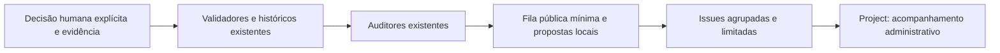

# Curadoria automatizada: solicitações, evidências e decisões

Implementação de manutenção do aplicativo **1.7.0**, ainda não lançado, com o catálogo **2.4.0 preservado**. Não altera C++/QML, quizzes, layout, perfis, pontuação ou conquistas. A execução normal do jogo continua offline. As ferramentas usam a biblioteca padrão do Python e a infraestrutura de governança existente.

## Arquitetura e limites



Não existe seta de fechamento/etiqueta da Issue para aprovação do catálogo. A automação semanal não executa `record-decision`, não importa texto de Issues como instruções e não modifica recursos ou datas de revisão. Propostas e solicitações não concedem permissões.

| Componente | Responsabilidade |
| --- | --- |
| `content_governance.py` | Integridade, direitos por foto/material, revisão científica/pedagógica, prazos, hashes e históricos existentes |
| `exploration_media.py`, `audit_hint_assistance.py` | Cobertura fotográfica, identidade/representatividade, assistência e lacunas educativas |
| `curation_requests.py` | Agregação dos achados, IDs, prioridade, fila JSON/Markdown, propostas locais e CLI |
| `curation_github.py` | Transporte limitado à API GitHub, paginação, deduplicação, atualização de blocos gerados e Projects v2 |
| `curation_decisions.py` | Modelos incompletos e encaminhamento explícito de decisões humanas aos validadores existentes |
| `curation_policy.json` | Repositório, limites e mapeamento administrativo; fora do catálogo embarcado |

O diagnóstico de referência produziu **15 solicitações agrupadas para 3.391 achados**, não 3.391 Issues. Contagens variam com revisões, conteúdo e vencimentos. São quatro assuntos científicos, dois taxonômicos, três fotográficos, quatro de direitos e dois pedagógicos. Rascunhos pedagógicos v3 são identificados separadamente da avaliação automática atual: não significam que todas as dicas competitivas estejam bloqueadas.

A verificação de dependências nesta fila é de escopo de manutenção: exige conferir o inventário Windows real pelo fluxo de `distribution.py`. Um checkout Linux não demonstra as obrigações dos binários distribuídos. A solicitação de dependências torna essa verificação visível; não substitui nem dispensa o gate do pacote.

## Uso local e propostas

Na raiz:

```powershell
python scripts/curation_requests.py plan
python scripts/curation_requests.py sync
```

`plan` gera `build/curation/requests.json` e `requests.md`. `sync` sem `--apply` não escreve no GitHub; sem token, produz uma prévia totalmente offline. Todos os relatórios/modelos ficam em `build/`, fora do Git. A CLI recusa gravá-los sobre os recursos científicos.

Para preparar uma proposta de documentação/correção, use o ID real da fila:

```powershell
python scripts/curation_requests.py correction-proposal --request-id ID_DA_FILA --output build/curation/private/proposta.json
python scripts/curation_requests.py authorization-draft --key ID_DA_FOTO --output build/curation/private/pedido.json
```

Os identificadores em maiúsculas são espaços a preencher. A proposta inclui achados/hashes e ações sugeridas, mas deixa alterações científicas e responsável em aberto. O pedido de autorização preserva o crédito indicado pela fonte, descreve o uso offline e mantém `contact_status=not_sent`, `consent=null`. Não descobre contatos, envia mensagens, assume titularidade do observador ou presume consentimento. Revisar titularidade, escolher o contato individual e enviar/acompanhar a resposta são tarefas humanas. Não anexar contratos ou comprovantes privados à Issue.

## Identidade, agrupamento e sincronização

- ID da solicitação: hash de versão, área e assunto; independe da quantidade de achados ou data da execução. Um novo achado atualiza o mesmo assunto.
- ID do achado: hash de área, assunto, recurso e código. Duplicatas são removidas; alterações no conteúdo/evidência mudam o fingerprint da solicitação.
- Marcador HTML estável na Issue, com bloco gerenciado e fingerprint. A busca pagina Issues **abertas e encerradas**, excluindo PRs. Paginação incompleta interrompe a publicação, evitando criar duplicatas por ausência de resultados.
- O texto fora do bloco gerenciado, título humano, etiquetas e estado administrativo são preservados. Uma releitura antes do PATCH reduz o risco de sobrescrever edições recentes; não oferece uma transação distribuída contra edições simultâneas na mesma descrição. Escreva notas humanas fora do bloco automático.
- Issue já encerrada com achados persistentes vai para `closed_unresolved`: não é reaberta nem substituída automaticamente. Múltiplas Issues com o mesmo ID ou marcadores ambíguos exigem triagem humana; não são mesclados/apagados.
- Relatos manuais não são deduplicados por inferência semântica. O mantenedor pode relacioná-los à solicitação agregada pelo ID público.

| Controle padrão | Valor |
| --- | ---: |
| Novas Issues por execução | 3 |
| Atualizações por execução | 8 |
| Chamadas por cliente GitHub | 200 |
| Páginas por listagem | 40, com 100 itens por página |
| Linhas de achados por descrição | 20; fila completa no relatório |
| Alterações de estado no Project | 10 |

Limites ficam em `scripts/curation_policy.json`, com tetos de segurança. Backlog continua nas execuções seguintes. Corpos idênticos não geram atualizações/comentários semanais. Escritas são espaçadas; erros 403/429, orçamento excedido e falhas de transporte interrompem o processo. POST não é repetido automaticamente, pois pode ter sido aceito antes de uma falha de resposta. A execução seguinte reconsulta os marcadores.

Há uma trava local `build/curation/sync.lock`, uma trava `decision.lock` para importações formais e concorrência única no workflow. Não execute escritores legados dos ledgers em paralelo com uma importação. Se o processo for interrompido e deixar a trava, confira que ele terminou antes de remover **somente esse arquivo**. Evite executar múltiplos sincronizadores em computadores diferentes simultaneamente; a API Issues não oferece chave atômica de idempotência para criação.

## Agenda, permissões e ativação no GitHub

Workflow: `.github/workflows/curation.yml`. Agenda às **09h17 de segunda-feira em São Paulo (12h17 UTC)**. A execução manual usa **simulação por padrão**; marcar `publish` permite a sincronização. Auditorias e simulação de leitura continuam semanais. A sincronização agendada só escreve se a variável de repositório **`GLOSSATA_CURATION_WEEKLY_SYNC`** for `true`; ausente, vazia ou `false`, não executa o job de escrita. A execução manual com `publish=true` é independente dessa chave e exige autorização explícita. O campo independente do Project só é preparado quando a opção manual correspondente é marcada.

O workflow só executa na branch padrão do repositório configurado. Eventos públicos de comentários/Issues/PRs não executam esse código com privilégios. O job de auditoria tem `contents: read` e `issues: read`: executa `sync` sem `--apply`, consulta commit e Issues reais e inclui o recibo `sync.json` no artefato. Somente o job de sincronização tem `issues: write`. Não há `contents: write`, commits, push ou publicação de releases. Checkout não persiste credenciais; actions estão fixadas por SHA.

O token automático do workflow é suficiente para Issues/etiquetas no próprio repositório quando `issues: write` é permitido. Fora do Actions, forneça `GH_TOKEN` por variável de ambiente segura, com acesso restrito ao repositório e Issues de leitura/escrita. Não o cole no chat, em arquivos, argumentos ou logs. Falta de permissão é erro explícito; não se troca de conta/token automaticamente. A API usa host fixo, recusa redirecionamento autenticado e não registra respostas brutas/credenciais.

Antes de escrever, o sincronizador verifica o repositório, a existência do commit de origem no GitHub e a árvore local limpa. Isso evita publicar referências a evidências de commits ainda não enviados. Como **não houve autorização de push**, esta implementação foi registrada localmente; workflow, formulários, etiquetas e Issues serão ativáveis após um push autorizado e integração na branch padrão. Não foi alegada uma execução remota do workflow nem a criação de Issues nesta entrega.

A agenda do GitHub pode sofrer atraso e pode ser desativada por inatividade em repositórios públicos; monitore Actions e use a execução manual quando necessário. Veja a [documentação oficial de eventos/agendamento](https://docs.github.com/en/actions/reference/workflows-and-actions/events-that-trigger-workflows) e [permissões de GITHUB_TOKEN](https://docs.github.com/en/actions/tutorials/authenticate-with-github_token).

## Etiquetas, formulários e Project

Issues em branco continuam permitidas para preservar os links de relato já usados pelo jogo. Os quatro formulários em `.github/ISSUE_TEMPLATE/` cobrem ciência/classificação, fotografia/crédito, educação/dicas e direitos/remoção. Pedem identificadores e fontes públicas, com avisos de privacidade. A primeira sincronização com escrita prepara as etiquetas; antes disso, o GitHub pode não aplicar etiquetas ainda inexistentes aos relatos. Relatos não são comandos nem aprovações.

Prioridades: **P0**, integridade/bloqueio urgente ou licença fora da política; **P1**, documentação de direitos, identificação conflitante ou revisão alterada; **P2**, revisão científica/conteúdo a preparar; **P3**, cobertura e propostas legadas. Não são conclusões jurídicas. Ausência de documentação não é apresentada como prova de licença incompatível.

| Etiqueta administrativa | Opção no campo `Curadoria` |
| --- | --- |
| `curadoria:pendente` | Pendente |
| `curadoria:em-analise` | Em análise |
| `curadoria:aguardando-evidencias` | Aguardando evidências |
| `curadoria:aprovada` | Aprovada |
| `curadoria:rejeitada` | Rejeitada |

Escolha uma única etiqueta de estado. Um conflito de etiquetas é reportado e não projeta estado arbitrário. Esses estados acompanham a **solicitação**, não autorizam coletivamente seus recursos. A aprovação/rejeição de cada afirmação/foto continua nos históricos da governança.

Para Projects v2:

1. Escolha/crie um Project próprio. Cadastre seu ID GraphQL na variável `GLOSSATA_CURATION_PROJECT_ID`.
2. Cadastre `GLOSSATA_CURATION_PROJECT_TOKEN` como **secret** com acesso ao Project e leitura das Issues. Pode ser PAT restrito ou token de App adequado à propriedade do Project. Não conceda escrita de código.
3. Execute manualmente com `publish` e `prepare_project_field`, ou use `project-setup --apply` com `GLOSSATA_PROJECT_ID` e `GLOSSATA_PROJECT_TOKEN` no ambiente local.
4. O comando cria apenas o campo `Curadoria` se ele não existe; não recria Project nem altera campos/opções existentes. Campo incompatível exige decisão humana. Issues automáticas e relatos manuais com etiquetas de curadoria entram no mesmo Project, com adição e atualização idempotentes.

Sem Project configurado, Issues e a fila funcionam normalmente, e o relatório informa `not_configured`. Com ID configurado e token inválido, a integração falha explicitamente; Issues já criadas permanecem rastreáveis e não são recriadas na tentativa seguinte. `GITHUB_TOKEN` não acessa Projects: confira a [orientação oficial](https://docs.github.com/en/issues/planning-and-tracking-with-projects/automating-your-project/automating-projects-using-actions) e o [contrato GraphQL](https://docs.github.com/en/graphql/reference/projects).

## Decisões formais e preservação do histórico

Prepare um modelo com ID da fila, Issue **real** e chave do registro. Os valores abaixo são espaços a substituir:

```powershell
python scripts/curation_requests.py decision-template --kind review --key CHAVE_DO_REGISTRO --request-id ID_DA_FILA --issue NUMERO_REAL --output build/curation/private/revisao.json
```

Preencha pessoa/identificador público responsável, data real, justificativa, escopo e evidência localizada. O modelo começa sem responsável/data e em estado pendente. Não é permitido declarar a automação como humano. A ferramenta valida a declaração e os hashes; não autentica identidade civil nem certifica a conclusão científica/jurídica.

| Tipo | Fluxo existente utilizado |
| --- | --- |
| `review` | `append_review`, `event_errors`, `status` e `review_history.jsonl`: afirmações, tópicos, assistência humana e `presentation:ID_DA_FOTO` |
| `permission` | `confirm_permission`, `permission_issues` e `permission_history.jsonl`: foto exata, bytes, licença/versão e evidências |
| `dependency` | `record_dependency_review` e `dependency_reviews.jsonl`: componente vinculado ao inventário real do pacote e obrigações/fontes |

Apresentação usa os mesmos status, prazos e ledger, mas não entra na geração de educação ou elegibilidade dos quizzes. A revisão vincula foto, metadados e associações; trocar bindings ou bytes invalida a avaliação. Nenhuma revisão foi inventada ou gravada no catálogo real nesta entrega.

Em permissões, preencha a versão e as evidências antes de recalcular o modelo com `decision-template --decision CAMINHO_DO_RASCUNHO`. Isso atualiza somente o hash proposto; não confirma a autorização. Evidências para ledger público devem ser resumos redigidos, com caminhos admitidos e hashes; prova confidencial não pode ser copiada como se fosse evidência pública. Os validadores existentes continuam exigindo prova específica de licença/versão, identidade e revisão humana. Referenciar bibliografia não concede direitos de reprodução.

Após a revisão humana explícita:

```powershell
python scripts/curation_requests.py record-decision --decision build/curation/private/revisao.json --apply
```

O envelope inclui o hash da decisão anterior esperado. Conteúdo alterado, evidência privada, pessoa/data ausentes, autoria automatizada ou decisão humana mais recente impedem a gravação. Reaplicar a mesma decisão é idempotente. Cada evento inclui ID da solicitação, URL da Issue e hash da decisão; cadeias anteriores são preservadas.

Direitos de arte, ícones, fontes, textos próprios, organização da coletânea e exceções contratuais continuam exigindo a escolha do mantenedor e alteração revisada dos manifestos originais (`asset_rights.json`, política de exceções e documentos de direitos). Não são convertidos automaticamente em permissões fotográficas. O sistema prepara/acompanha essas solicitações; não escolhe uma licença para o autor.

Decisões que mudam dados publicados devem seguir geração, auditoria, versão independente do catálogo, histórico e revisão do diff conforme [VERSIONAMENTO.md](VERSIONAMENTO.md). O comando de decisão não faz push nem publica um lançamento; os gates permanecem obrigatórios.

## Privacidade e manutenção

Somente um DTO público selecionado pode sair pelo sincronizador: códigos, estados, IDs, hashes e referências de caminhos admitidos. Não são copiados textos livres de erros, contratos, contatos, perfis de observadores, bancos de jogadores ou coordenadas. Referências fora da lista pública, com campos privados ou padrões conhecidos de segredo são omitidas, com indicação de retenção. Esse filtro reduz exposição; não equivale a revisão universal de dados pessoais. Revise os relatórios antes da primeira publicação.

O workflow publica somente `requests.json`, `requests.md` e `sync.json`; não envia o diretório `private/`, arquivos de decisão ou relatórios brutos de permissão. Fila, recibos e resumo da execução documentam backlog, conflitos, falhas parciais e Issues encerradas ainda pendentes. Artefatos duram 30 dias; as evidências e decisões duradouras permanecem no repositório e nas cadeias de governança.

Testes específicos:

```powershell
python tests/test_curation_requests.py
python tests/test_curation_github.py
python tests/test_curation_decisions.py
python tests/test_curation_workflow.py
ctest --test-dir build --output-on-failure
```

Cobrem deduplicação e limites, paginação incompleta, recusa 403, ausência de token, commit não publicado, preservação de notas/etiquetas, Issues encerradas, Project idempotente, status conflitantes, evidência privada, hashes, nova decisão concorrente e reabertura dos históricos sem apagar decisões. As integrações de escrita usam replay determinístico, sem credenciais reais; a execução remota aguarda ativação autorizada.

## Verificação desta entrega

Validação local em **2026-10-16**, com bancos temporários:

| Verificação | Resultado |
| --- | --- |
| Compilação C++17/Qt 6 e CTest | Compilação concluída; 15/15 suítes, incluindo domínio, interface real e quatro novas suítes de curadoria |
| Novos testes de curadoria | 36 casos: fila (6), GitHub/Projects (16), decisões (11) e automação/formulários (3) |
| Workflow | `actionlint` 1.7.12: workflows de curadoria e qualidade válidos; formulários conferidos contra o contrato documentado e invariantes locais |
| QML e captura | `qmllint` sem erros; captura real recompilada em 1.7.0, perfil temporário, Discord desativado; pixels da tela inicial preservados |
| Reprodutibilidade | Educação e créditos regenerados sem diferenças; metadados/hashes de versão válidos |
| Catálogo e mídia | Auditoria técnica estrita e exploração sem erros; 122 organismos, 120 fotos únicas de quiz, 109 fotos de apresentação; 558 arquivos em `resources/` byte a byte iguais à referência `ef70d7c` |
| Sincronização local | Simulação offline sem token: nenhuma chamada de rede, Issue, etiqueta, Project ou contato externo alterado |
| Gate de distribuição | **Bloqueado**, como previsto: documentação pendente em 120 fotos, 7 outros recursos e 146 mídias não embarcadas; 2 bloqueios científicos de origem preservados |

Aplicativo 1.7.0 e catálogo 2.4.0 permanecem não lançados. O pacote local anterior não foi publicado como 1.7.0. A integração remota precisa de envio autorizado à branch padrão. O mantenedor informou que não existe Project e determinou que nenhum seja criado neste plano; essa integração permanece opcional. Testes com transporte simulado verificam os contratos e falhas previstas, sem demonstrar permissões efetivas de um token ainda não configurado ou substituir revisão científica/jurídica humana.

## Preparação e autorizações para ativação

Preparação verificada em **2026-10-16**, sobre a implementação `56d8da4149f62b2eca029d357536b40de4b5fb84`, com a proteção semanal e simulação autenticada do commit **`71554769135a812bb3be91dfec0383c9f77cea5b`**. Este registro não é uma data de ativação remota.

| Item | Evidência efetivamente observada |
| --- | --- |
| Checkout inicial | Limpo; branch `feat/classificacao-filogenetica`; nenhum trabalho preexistente descartado |
| Referência remota | `git fetch origin main` concluído; `origin/main` em `dd69feb3e4af01ce06726c80cf5828e8b8750d15`; nenhuma divergência atrás e 19 commits locais à frente antes desta preparação |
| Implementação 1.7.0 | Commits locais `bff485d`, `7bb8c06`, `302368c`, `56d8da4` presentes; workflow ainda ausente da árvore de `origin/main` consultada |
| CLI e conta | GitHub CLI 2.100.0; inicialmente sem login. Após autenticação pelo mantenedor: `kaduolliver` ativo via keyring/HTTPS, escopos OAuth `repo`, `workflow`, `read:org`, `gist`; API confirmou `admin`, `maintain`, `pull`, `push`, `triage` |
| Testes locais | Quatro suítes específicas: 37 casos (6/16/11/4); CTest 15/15 em 79,92 s; após corrigir tabelas Markdown, suítes afetadas repetidas com sucesso |
| Auditorias | `actionlint`, `qmllint`, catálogo estrito, exploração, metadados e histórico visual aprovados; educação/créditos reproduzíveis sem diferenças |
| Histórico proposto inicial | 702 objetos, incluindo 524 blobs novos em `origin/main..56d8da4`, sem artefatos proibidos ou padrões conhecidos de segredo; verificação limitada, não certificação universal |
| Simulação local | 15 solicitações, 3.391 achados; `apply=false`, `remote_checked=false`, nenhuma alteração remota; CLI sem autenticação |
| Permissões efetivas consultadas | Actions habilitado; token padrão dos workflows em leitura, sem aprovação de PRs; `main` sem proteção e sem ruleset listado. Nenhuma dessas permissões foi ampliada |
| Direitos e ciência | Gate continua **bloqueado**: 120 fotos, 7 outros materiais, 146 mídias não embarcadas e 2 bloqueios científicos de origem; nenhuma autorização de distribuição presumida |
| Ativação e execuções reais | **Não realizadas**: sem push autorizado, run ID remoto, Issue criada/atualizada ou data de ativação |
| Chave semanal | Variável remota `GLOSSATA_CURATION_WEEKLY_SYNC=false`, conferida pela API; `updated_at=2026-10-16T18:52:57Z`. Código recusa escrita sem `true`; auditorias não dependem dessa chave |
| Baseline de Issues | API autenticada consultada após configurar a proteção: nenhuma Issue existente; nenhum relato criado, editado ou encerrado |

O envio desta branch inclui evoluções anteriores ainda locais: classificação filogenética, provedores, fotografias de exploração, dicas e curadoria. Não consiste apenas nos quatro commits de manutenção. O resumo do intervalo, arquivos, fotografias e pendências deve ser apresentado ao mantenedor antes do primeiro push. Nenhum executável, banco de jogador ou artefato de compilação pode entrar nesse envio.

A sequência possui três autorizações distintas, conforme o plano do mantenedor:

1. **Publicação do código/histórico:** depois de revisar o resumo, autorizar o primeiro push e a integração apropriada à branch padrão. Respeitar proteções e verificações existentes; não forçar referências, criar tags/releases nem desativar gates. Reconsultar a base remota antes do envio.
2. **Primeira escrita em Issues:** somente após o workflow remoto com `publish=false` terminar e ter logs, artefatos, recibo e ausência de escrita verificados. Revisar os três primeiros candidatos e autorizar `publish=true` separadamente.
3. **Escrita semanal:** somente após execuções reais verificadas por IDs, limites, deduplicação e preservação humana. Autorizar a alteração da variável para `true` separadamente.

Se o CLI estiver sem login, o mantenedor deve usar `gh auth login --hostname github.com --git-protocol https --web` no próprio terminal e concluir pelo navegador. Não enviar tokens/senhas em Issues, chat ou arquivos. Consulte o [manual oficial do login](https://cli.github.com/manual/gh_auth_login). Depois, verificar a conta ativa e as permissões efetivas de Actions/Issues; permissão administrativa da conta não prova o escopo do token usado pelo CLI.

Antes do envio autorizado, manter a chave explicitamente em `false` quando houver autenticação administrativa. Isso não desliga auditorias. A configuração pode ser conferida na interface de variáveis de Actions; os comandos abaixo só devem ser usados no ponto autorizado correspondente:

```powershell
# Proteção inicial: impede somente escritas semanais.
gh variable set GLOSSATA_CURATION_WEEKLY_SYNC --repo kaduolliver/Projeto-Glossata --body false

# Depois do envio/integração autorizados: simulação remota, sem publicar Issues.
gh workflow run curation.yml --repo kaduolliver/Projeto-Glossata --ref main -f publish=false -f prepare_project_field=false
```

Identificar o run pelo commit, evento e horário, acompanhar sua conclusão e baixar os artefatos pelo ID exato. Conferir que `remote_checked=true`, `apply=false`, `created=[]`, `updated=[]`, que o job de escrita foi ignorado e que as Issues não foram modificadas. Falha ou ausência de autenticação não pode ser descrita como integração real validada.

Na primeira publicação autorizada, comparar snapshots públicos mínimos por ID estável, número da Issue, hash do corpo, etiquetas, estado e data de atualização; conferir também comentários e trechos humanos. A contagem total pode crescer legitimamente enquanto houver backlog. Não criar ou encerrar Issues de teste sem escopo autorizado, nem encerrar solicitações porque sumiram de um relatório. Reexecução e atualização devem preservar evidências e o histórico científico.

Após cada etapa real, acrescentar aqui commit/run IDs, URLs de Issues, limites observados, permissões, conflitos, resultado da deduplicação e estado verificado da variável. **Data real de ativação: pendente.** Até essas etapas, o sistema está preparado localmente; não há declaração de operação semanal remota nem de liberação pública do executável.
