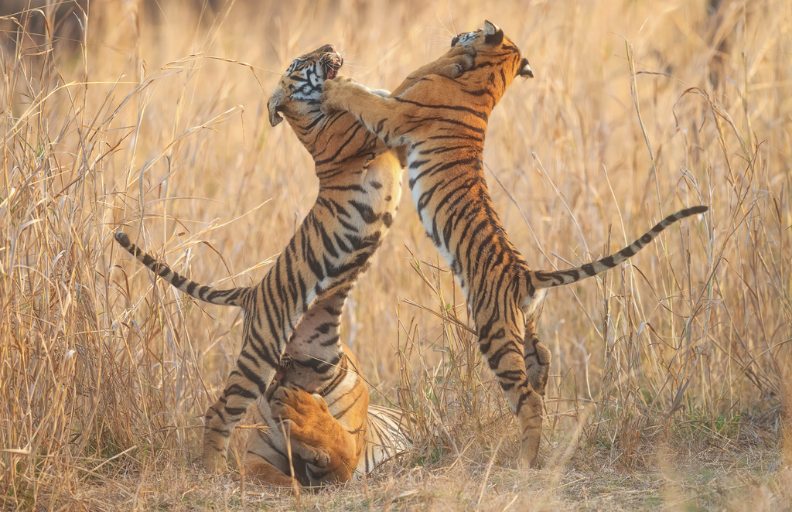
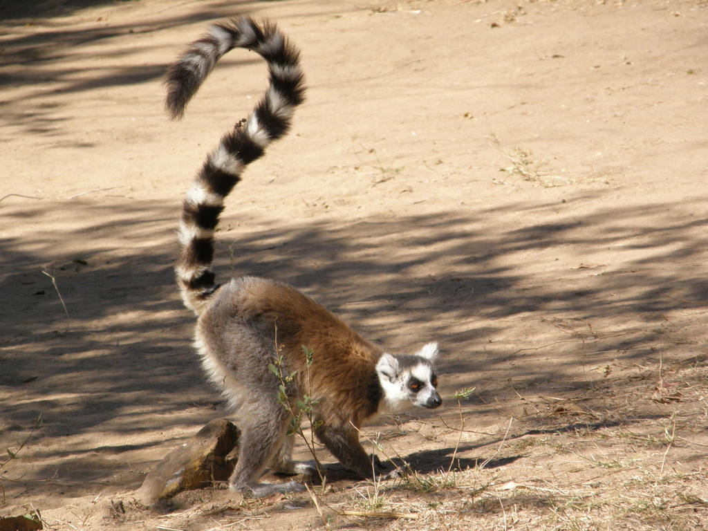

# Etapa 1 — fotografias prioritárias (Issues #4 e #22)

As duas substituições foram aplicadas após a resposta expressa do mantenedor:
“Aprovo editorialmente as duas associações e dicas”. A declaração, os hashes,
as evidências minimizadas da API e os quatro eventos editoriais estão
vinculados em [ETAPA_1_FOTOGRAFIAS.json](ETAPA_1_FOTOGRAFIAS.json).
Não houve confirmação de permissão ou revisão especializada.

## Conferência editorial proposta — 19/10/2026

As observações antigas 386235634 (foto 707161720, organismo 125) e
361508293 (foto 659755043, organismo 128) continuam `casual`, com
`captive: true` e votos `wild: false`. As identidades comunitárias coincidem
com *Panthera tigris* e *Lemur catta*. Cativeiro não demonstra identificação
incorreta, mas não atende ao filtro Research Grade do catálogo.

| Organismo preservado | Fotografia proposta | Identificação da fonte | Crédito da foto | Licença declarada |
| --- | --- | --- | --- | --- |
| 125 — *Panthera tigris* | [111317641](https://www.inaturalist.org/photos/111317641), [observação 68706928](https://www.inaturalist.org/observations/68706928) | *Panthera tigris tigris*, táxon 130793, Research Grade; ancestral espécie 41967 | Morten Ross, conforme atribuição da API | CC BY; versão ainda não comprovada |
| 128 — *Lemur catta* | [2068079](https://www.inaturalist.org/photos/2068079), [observação 1707124](https://www.inaturalist.org/observations/1707124) | *Lemur catta*, táxon 43617, Research Grade | Rafael Medina, conforme atribuição da API | CC BY; versão ainda não comprovada |

As imagens são as variantes `large` fornecidas pela fonte, sem recorte ou
retoque local. A triagem visual pelo agente é uma proposta, não uma revisão
humana ou por especialista. Pegadas, fezes e detalhes insuficientes encontrados
na busca foram descartados para o quiz visual. Research Grade não basta para
demonstrar adequação pedagógica.

A proposta editorial abrange somente a associação destas fotos aos dois
organismos e seu uso nos níveis espécie, gênero, família, ordem, classe, filo
e reino já utilizados, sem perguntas sobre subespécies. A classificação
*P. t. tigris* permanece registrada como identificação da observação; não se
altera a taxonomia do organismo 125 nem se atribui grau científico a outra
observação. O ancestral 41967 consta expressamente na resposta da fonte.

Também se propõe renovar apenas o vínculo fotográfico das duas dicas existentes:

- 125: “Observe se as marcas da pelagem são listras, em vez de manchas arredondadas.”
- 128: “Concentre a comparação na longa cauda e na alternância de anéis pretos e brancos.”

As redações e fontes científicas anteriores permanecem; mudam somente as fotos
às quais a observação visual se refere. A conferência não aprova graus de
assistência, tópicos agregados de morfologia, direitos autorais ou distribuição.
As revisões antigas não podem ser transferidas automaticamente às novas fotos.

## Direitos e limites

A API declara CC BY individualmente, sem versão. As páginas de fotografia
consultadas responderam HTTP 403; não houve tentativa de contornar a restrição.
A versão não será inferida do código `cc-by` ou do padrão do importador.
Permissão de download segundo a política existente e confirmação documental
para distribuir são verificações distintas. A confirmação de permissão e o
gate de distribuição continuam pendentes; nenhum consentimento externo é criado.

Os arquivos e evidências anteriores permanecem preservados. A substituição
retira as fotos antigas apenas do uso ativo e dos recursos embarcados, não do
histórico. Esta etapa não encerra a Issue #4 nem resolve seus demais achados.

## Resultado e pendências

| Verificação | Antes | Depois |
| --- | --- | --- |
| Organismos / receitas de dicas | 122 / 855 | 122 / 855; conteúdo das receitas idêntico |
| Fotografias distintas do quiz | 120 | 120; duas substituições |
| Casos prioritários com origem Casual no catálogo ativo | 2 | 0 |
| Indicadores de notas utilizáveis: etimologia / morfologia | 49 / 104 | 49 / 104 |
| Conjunto competitivo elegível | 80 | 80 |
| Bloqueios científicos de distribuição | 277 | 275; dois vínculos fotográficos resolvidos editorialmente |
| Fotos ativas com pendências documentais de permissão | 120 | 120; nenhuma confirmação criada |
| Eventos de revisão | 1.047 | 1.051; prefixo anterior preservado integralmente |

A classificação dos 122 organismos e os textos educativos não mudaram. A
avaliação automática de dicas e `education.json` foram regeneradas pelos
geradores existentes; apenas os vínculos de mídia, hashes e revisões afetadas
mudaram. Os pesos leve/moderado/forte, pontos, regras, banco e histórico dos
jogadores permanecem inalterados. O manifesto continua sendo o catálogo
2.4.0 não lançado, aplicativo 1.7.0, sem tag, pacote ou release.

As fotos antigas continuam presentes no Git e são apontadas pela governança
como mídias não embarcadas com permissão documental pendente. A confirmação
de versão/URL da licença e a revisão de permissão das duas novas fotos
continuam necessárias no fluxo `confirm-permission`, quando houver evidência
suficiente. O `license_url` do formato legado aponta ao destino convencional
CC BY 4.0, mas `photo_provenance.json` registra explicitamente versão e URL
declarada como desconhecidas. Esse valor convencional não é evidência nem
libera o gate; a interface e os créditos mantêm o aviso de versão não comprovada.

Não se exige alterar a política de importação para a substituição: a decisão
editorial específica do mantenedor cobre a imagem de *P. t. tigris* como
representante de *P. tigris*, com ancestralidade documentada, sem admitir
automaticamente outras subespécies ou modificar o filtro do importador.

Uma captura real da tela inicial foi renovada com perfil temporário porque
seu registro de integridade inclui `species.json`; os pixels permanecem
idênticos à captura anterior. Nenhum layout foi alterado.

## Validação executada

Compilação Release com C++17/Qt 6 concluída; CTest **26/26 suítes aprovadas**
em **194,42 s**, incluindo 52 casos do núcleo, testes reais QML e os testes
de identidade permanente, Unicode, checkpoint, concorrência e recuperação da
governança. Os testes de importação verificam as duas substituições, os
snapshots, a ancestralidade, os créditos, a invalidação após mudar o vínculo
fotográfico, a preservação dos direitos textuais e o prefixo dos 1.047 eventos.

A comparação histórica da migração filogenética agora distingue estas duas
substituições documentadas sem alterar seu snapshot original. O teste do lote
textual consolidado executa no commit em que os 1.047 eventos foram incorporados;
os testes atuais verificam separadamente as quatro decisões novas e os direitos.
Nenhum validador de produção foi alterado.

Aprovados: auditoria estrita dos 122 organismos, licenciamento Apache 2.0,
manifestos e metadados de versões, cadeia/prefixo de governança, recuperação de
permissões, qmllint, fotografias de exploração e classificação filogenética.
Gerador educativo, avaliação de dicas e créditos reproduzem os arquivos
publicados. A cobertura real de dicas gerada pelo teste C++ permanece idêntica.

`distribution.py check` continua recusando distribuição, sem erros técnicos,
com 120 registros fotográficos pendentes e 275 bloqueios científicos. Permanecem
também as duas mídias antigas não embarcadas. Isso é o resultado esperado do
gate; testes aprovados não equivalem a certificação científica ou jurídica.
