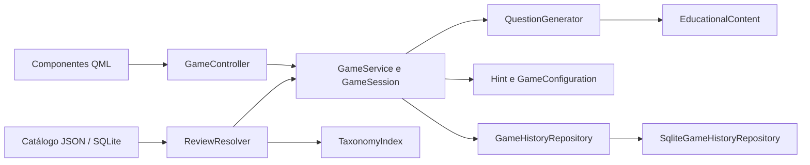

# Evolução de engenharia, aprendizagem e competição

> Registro hist?rico: marca??es antigas de verifica??o/aprova??o n?o demonstram revis?o humana rastre?vel. Consulte a [governan?a atual, matriz e pend?ncias](CONFORMIDADE.md). Cobertura t?cnica n?o ? certifica??o cient?fica ou jur?dica.

## Auditoria e decisões

Etapa implementada no workspace `C:\glossata_game`, com C++17, Qt Quick e SQLite. O catálogo continua com 122 organismos; nenhuma espécie, fotografia, perfil ou resposta histórica foi removida nesta etapa.

Antes das alterações, GameService construía alternativas aleatórias e repetia a geração até oito vezes para procurar uma dica taxonômica. QuizSelection verificava repetidamente todas as combinações de organismos, embora quatro respostas distintas fossem uma condição global do conjunto. O controlador preservava corretamente a pergunta respondida, mas não tinha transição de revisão para resultado após um término automático. O histórico guardava a última pontuação por nome, e as estatísticas exibiam somente a partida em memória.

As alterações mantêm as APIs existentes de início do modo Livre e introduzem configuração explícita, geração separada e consultas específicas ao histórico. Não foram criadas hierarquias de serviços nem substituída a arquitetura.



QuestionGenerator centraliza alternativas, proximidade, contexto e montagem da pergunta. GameService coordena o ciclo e o salvamento. Hint continua sendo a única regra de tetos de pontuação, sem cálculo em QML. GameConfiguration registra condições comparáveis; SessionMetrics acumula respostas com uma regra compartilhada pela partida e pelo histórico persistido. TaxonomyIndex conserva a árvore e passa a armazenar os níveis disponíveis em cache, pois o catálogo embarcado é imutável durante a execução.

O ranking e as métricas históricas ficam em cache no controlador, atualizados ao salvar, trocar perfil ou selecionar uma modalidade. A UI não consulta o SQLite continuamente por meio de getters.

## Alternativas e dificuldade

O modo Livre oferece três políticas configuráveis:

| Política | Seleção |
|---|---|
| Mais amplas | Prefere distratores mais distantes na linhagem científica, dentro do filtro selecionado |
| Equilibradas | Compara duas alternativas próximas e uma mais abrangente |
| Mais próximas | Exige um ancestral suficientemente próximo ou características morfológicas explicitamente documentadas |

Todas exigem quatro respostas distintas, uma única resposta correta, nível coerente e fotografias aprovadas para aquele nível. O gerador também verifica esses requisitos, mesmo se receber um conjunto ainda não filtrado. O grupo selecionado vale para a resposta e os distratores. Uma questão próxima sem três distratores adequados não é produzida.

Proximidade taxonômica significa compartilhar um ancestral científico anterior ao nível perguntado. Para espécie/gênero na política próxima, o requisito taxonômico é compartilhar família; para família, ordem; para ordem, classe; para os demais níveis, a regra está declarada em QuestionGenerator. Não se presume que parentesco implique semelhança visual.

Características revisadas são um sinal separado. Nesta etapa, onze organismos possuem descritores físicos explícitos, reutilizando as fontes das fichas: pelagem, listras, rosetas, juba, folhas em leque, armadilhas foliares e formas de corpos de frutificação. Não foram inferidos descritores apenas a partir do nome ou da família. Para alternativas que representam vários organismos, o gerador usa representantes documentados; isso não afirma que todos os integrantes do táxon tenham aquela aparência.

Os rótulos descrevem políticas de seleção, não uma dificuldade pedagógica medida experimentalmente. Não existe garantia de dificuldade equivalente entre quaisquer espécies. A versão inicial do Competitivo fixa a política Equilibradas para todos.

## Validação das dicas

A escala permanece exata: nenhuma dica/taxonômica = 6 unidades, etimológica = 3, morfológica = 2; erro = zero. Abrir o painel não conta, revisitar não conta novamente, combinações mantêm o menor teto e a próxima pergunta restaura seis unidades.

A dica taxonômica precisa citar um ancestral verificado mais amplo que o nível solicitado e deixar **pelo menos três das quatro alternativas compatíveis**. Nenhuma alternativa é tratada como compatível se sua linhagem é desconhecida ou contraditória. Um reino compartilhado por todas as opções continua sendo descartado como contexto excessivamente genérico.

Etimologias precisam de identidade, nível, referência e aprovação específicos. O iNaturalist não é aceito como fonte etimológica pelo gerador. A origem exibida após responder usa as mesmas notas, sem recomputar pontuação. Interpretações incertas ficam registradas como pendentes e não entram nas dicas.

Morfologia requer revisão aprovada, referência, nível apropriado e o ID da foto revisada. Textos com a resposta literal ou nomes taxonômicos que entreguem a identificação são rejeitados. Quando os descritores revisados também se aplicam às três alternativas incorretas, a ajuda morfológica fica indisponível. Ausência de descritores dos distratores não é interpretada como prova de diferença.

Os controles estruturais não substituem análise semântica por um especialista. A identificação fotográfica é examinada independentemente da descrição biológica. A fotografia 655494534, vinculada a Plodia interpunctella, apresentou um padrão de asas divergente da [descrição UF/IFAS IN153](https://ask.ifas.ufl.edu/publication/IN153). Sua revisão passou para in_review e a espécie está suspensa das perguntas, preservando cadastro, arquivo e histórico. Não foi atribuída uma nova identificação à imagem.

## Conteúdo científico e curadoria

A cobertura passou de 22 para **49 organismos com ao menos um elemento etimológico documentado**. Isso não significa origem completa do gênero e do epíteto para todos os 49. Permanecem **104 registros morfológicos** e **16 introduções de táxons**. As 18 lacunas morfológicas não foram preenchidas com características genéricas ou incompatíveis com a fotografia.

As novas fontes incluem [LPSN/DSMZ](https://lpsn.dsmz.de/), [nomenclatura de fungos de Pat O'Reilly](https://www.first-nature.com/fungi/~naming.php), [NCSU](https://plants.ces.ncsu.edu/plants/dionaea-muscipula/), [estudo etnobotânico sobre Dracaena cinnabari](https://link.springer.com/article/10.1186/s13002-021-00452-1) e a [biblioteca da San Diego Zoo Wildlife Alliance](https://ielc.libguides.com/sdzg/factsheets/ringtailedlemur/taxonomy). Cada nota conserva URL, título, data e identidade. Fontes anteriores continuam documentadas em DICAS_E_PONTUACAO.md e species_profiles.json.

O corpus preserva hint_education.json e education.json. curation_reviews.json adiciona estados independentes para taxonomy, photo, etymology, morphology e education: pending, in_review, approved e rejected. Uma etimologia pendente não bloqueia a espécie; uma fotografia não aprovada bloqueia perguntas que dependem dela. ID/nome e ID da fotografia são verificados na geração e na carga, inclusive após reabrir o catálogo SQLite.

As aprovações iniciais reutilizam a curadoria anterior; não representam certificação externa ou análise molecular. É necessário atualizar o estado e regenerar education.json ao concluir uma nova revisão. Nenhuma pesquisa ocorre durante partidas.

research_etymology.py é um utilitário de manutenção. O arquivo etymology_research.json registra fontes consultadas, falhas de acesso, elementos confirmados e pendências por organismo. A triagem inicial consultou 90 URLs distintas, com 60 acessos bem-sucedidos; pesquisas manuais posteriores ampliaram as notas aprovadas. Também foi executada uma busca nominal de origem do gênero/epíteto para cada um dos 77 organismos ainda pendentes naquele momento, com consultas registradas por identidade. Quatro novos registros puderam ser confirmados, incluindo [Heliconius melpomene](https://www.heliconius.org/species/heliconius-melpomene/), [Phytoplasma asteris](https://lpsn.dsmz.de/species/phytoplasma-asteris), [Favolaschia claudopus](https://www.first-nature.com/fungi/favolaschia-claudopus.php) e [Durvillaea antarctica](https://www.nzpcn.org.nz/flora/species/durvillaea-antarctica/). Encontrar uma palavra numa página ou obter HTTP 200 **não aprova** uma etimologia. Essa pesquisa não substitui uma revisão exaustiva de todas as descrições originais. Os 73 organismos sem notas aprovadas e os elementos ainda ausentes nos demais continuam pendentes; não se afirma que seus nomes sejam desconhecidos na literatura.

Em Gomphosphaeria, a interpretação provável do gênero foi registrada separadamente e não disponibilizada como dica; somente o epíteto confirmado entra no conteúdo jogável. Em Favolaschia claudopus, a origem do gênero foi documentada, mas a interpretação incerta do epíteto apresentada pela página foi deixada pendente. Significados históricos relacionados a consumo ou propriedades medicinais são apresentados como origem linguística, sem recomendar usos.

## Modos e rankings

**Livre:** perguntas contínuas, filtros e níveis existentes, dificuldade selecionável, dicas e pontuação fracionária, encerramento voluntário. O ranking do Livre mostra recordes de treinamento; grupos e durações variáveis não são apresentados como competição padronizada. Monera conserva a experiência por informações documentadas e imagens explicitamente marcadas como apoio, conforme a autorização anterior; essas fotos não comprovam a espécie nem entram no Competitivo.

**Competitivo:** inicialmente 20 questões, configuradas por GameConfiguration::CompetitiveQuestionCount; todas as espécies elegíveis com fotos de identificação, nível gênero, política Equilibradas. Não repete organismos. Após a vigésima resposta, finaliza e salva uma vez, mantém a revisão dessa resposta e oferece Ver resultado final. Respostas duplicadas são bloqueadas. Partidas interrompidas ficam persistidas com is_complete=0 e não entram no ranking competitivo.

O ranking principal de cada modalidade usa a **melhor pontuação**; a última partida é armazenada e apresentada separadamente. O exemplo 25 → 10 → 17 mantém recorde 25 e última 17. Os pontos não são somados entre partidas.

Critérios de desempate: unidades maiores, mais acertos, data mais antiga do recorde, nome COLLATE NOCASE e nome literal. Em empate de pontos no recorde de uma pessoa, mais acertos melhora o registro; em empate também de acertos, conserva-se a conquista mais antiga.

A chave competitiva inclui modo, limite, grupo, nível, dificuldade, versão das regras e SHA-256 do conteúdo de espécies/taxonomia/educação. Não mistura durações, filtros, níveis ou versões diferentes. Uma revisão do conteúdo pode criar uma nova classificação competitiva; os registros anteriores permanecem no banco, embora a UI inicial selecione o formato atual. Cada partida sorteia um subconjunto do mesmo catálogo: isso padroniza condições, mas não garante dificuldade empírica idêntica ou o mesmo conjunto de vinte organismos para todos.

## Estatísticas

Na partida e no histórico disponível do perfil:

- Precisão = acertos / respostas.
- Média de pontos = unidades / (6 × respostas), arredondada somente na apresentação.
- Acertos sem dicas = respostas corretas com máscara zero, inclusive distinguindo-as da dica taxonômica sem custo.
- Questões com dicas = respostas com qualquer categoria; cada questão conta uma vez.
- Categorias reveladas = soma das categorias distintas por resposta; reconsultas não contam.
- Uso de cada categoria = quantidade de questões cuja máscara contém aquela categoria.
- Eficiência = unidades / (6 × respostas), apresentada como percentual.

O histórico é calculado diretamente de answer_records, filtrando perfil e ranking_key. Para competição, inclui somente partidas completas do formato selecionado. Registros antigos sem respostas detalhadas não recebem métricas inventadas. O agrupamento por reino e filo/divisão permanece relativo à partida atual, usando IDs científicos, sem reclassificar retrospectivamente respostas antigas com a taxonomia atual.

## Banco, migração e preservação

O caminho de glossata_history.sqlite permanece igual. PRAGMA user_version=2 versiona a evolução; bancos com versão futura são recusados sem alteração. O marcador score_units continua garantindo que a migração antiga de escala aconteça uma única vez: 10 pontos antigos = 60 unidades = 10,00.

Toda a evolução de esquema e reconstrução de recordes ocorre numa transação. legacy_history_results conserva as linhas disponíveis de history antes da consolidação de nomes. history mantém compatibilidade com o resultado mais recente do Livre. A nova ranking_records armazena recorde e último resultado por chave de configuração/nome, sem substituir o recorde por pontuação inferior.

game_runs recebe modo, limite, grupo, nível, dificuldade, versões, chave de ranking, unidades, acertos, respostas e estado de conclusão. answer_records e player_profiles são preservadas. As partidas anteriores com respostas completas têm pontos/acertos reconstruídos por SUM e COUNT; partidas sem essas respostas não recebem resultados supostos. Nenhum recorde perdido por sobrescrita em versões que não guardavam partidas pode ser recuperado com segurança.

UUID e comparação do conteúdo completo tornam reenvios idempotentes. O mesmo UUID com outro organismo, resultado ou configuração é rejeitado. Partida, respostas, atualização da última partida e recorde são salvos atomicamente. Falhas mantêm o resultado pendente; nova tentativa não duplica respostas. PRAGMA foreign_keys e foreign_key_check protegem a integridade referencial. A migração interrompida retorna o banco ao esquema/valores originais e pode ser repetida após resolver a falha.

## Arquivos relevantes

| Arquivo | Responsabilidade |
|---|---|
| src/application/QuestionGenerator.h | Políticas, proximidade, alternativas e construção da pergunta |
| src/application/GameService.* | Configuração, ciclos Livre/Competitivo e encerramento |
| src/domain/GameConfiguration.h | Condições, chave competitiva e métricas compartilhadas |
| src/domain/GameSession.h, QuizSelection.h e Species.h | Estado, elegibilidade e sinais revisados |
| src/application/EducationalContent.cpp | Contexto das dicas, aprovação e origem documentada |
| src/application/TaxonomyIndex.* | Contagens aprovadas e cache de níveis |
| src/infrastructure/content/ReviewResolver.h e adaptadores de catálogo | Aplicação das revisões em JSON e SQLite |
| src/infrastructure/persistence/SqliteGameHistoryRepository.* e porta | Migração, recordes, última partida, isolamento e métricas persistidas |
| src/presentation/GameController.* | Snapshots, término automático, cache e apresentação |
| resources/qml/components/PlayModeSelector.qml e views | Modos, dificuldade, resultado e novas métricas |
| resources/data/curation_reviews.json, hint_education.json, education.json | Revisões e conteúdo embarcado |
| resources/data/etymology_research.json | Referências pesquisadas e pendências |
| scripts/build_education.py, audit_catalog.py, research_etymology.py | Geração, auditoria offline e triagem de manutenção |
| scripts/package.ps1, validate_package.ps1 e src/app/main.cpp | Empacotamento e smoke test com bancos temporários |
| tests/GameServiceTests.cpp, QmlInterfaceTests.cpp e test_import_inaturalist.py | Regressões e novos fluxos |

## Validação e distribuição

Comandos executados:

```powershell
python scripts/build_education.py
python scripts/audit_catalog.py --strict
cmake --build build --parallel 4
ctest --test-dir build --output-on-failure
qmllint <arquivos QML> --unqualified disable
powershell -ExecutionPolicy Bypass -File scripts/package.ps1
powershell -ExecutionPolicy Bypass -File scripts/validate_package.ps1
```

Resultados da rodada final de regressão:

| Verificação | Resultado |
|---|---|
| Build Release | Aprovado |
| CTest | 4/4 suítes aprovadas, 30,99 segundos |
| Qt principal | 39 resultados aprovados, incluindo inicialização/finalização, zero falhas |
| Qt interface | Fluxo completo aprovado, três resultados Qt incluindo inicialização/finalização |
| Importação/conteúdo Python | 14 testes aprovados, sem rede |
| qmllint | Código zero, sem avisos |
| Auditoria estrita | Código zero, nenhuma licença incompatível ou problema estrutural de classificação |
| Pacote com PATH isolado | Código zero após inclusão de offscreen; nenhum módulo MSYS2 externo na inspeção registrada |

As regressões anteriores de pontuação mantêm os oito conjuntos de dicas e 600 respostas sem erro acumulado. Novos testes percorrem sete níveis e três políticas, impedem organismos sem revisão, validam vinte espécies diferentes no Competitivo, término após a última resposta, partidas interrompidas, separação por duração/dificuldade/conteúdo, recorde/última partida, empate, máscaras sem dupla contagem, métricas persistidas, reabertura e migração interrompida com rollback/retry.

O fluxo QML exercita ambos os modos, as vinte respostas competitivas, revisão final, duplicação bloqueada, resultado, seletores de ranking e screenshots em janelas normal e compacta. A ambiguidade de objectName entre os dois ComboBox foi corrigida no teste, buscando o popup no próprio seletor.

O smoke test utiliza bancos temporários, desativa publicação Discord e verifica inicialização QML/catálogo/SQLite e disponibilidade de questão competitiva. O primeiro teste isolado encontrou o plugin offscreen ausente; ele foi incluído no pacote e a repetição passou. PATH contém somente o pacote e diretórios do Windows; o script registra os módulos carregados e rejeita dependências do MSYS2 externo. A execução usa offscreen/software.

Isso **não equivale a teste numa instalação limpa do Windows**: a máquina hospedeira ainda possui Qt/MSYS2 instalados e não foi disponibilizada uma VM limpa. Gráficos nativos, hardware e instalação em outro computador continuam pendentes. O deploy também mantém os avisos conhecidos de traduções Qt ausentes e componentes opcionais de Direct3D 12. Os textos do próprio jogo estão em português.

Resultados finais e diagnóstico quantitativo estão registrados ao fim desta etapa nos arquivos de build e no documento COBERTURA_TAXONOMICA.md. Limitações científicas e registros pendentes não são apresentados como conteúdo concluído.
