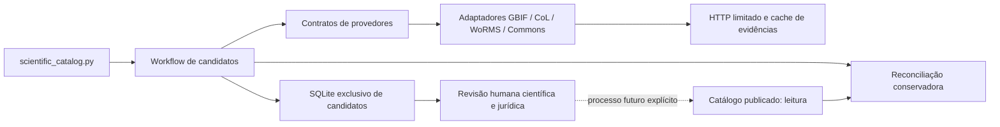

# Rede de provedores científicos

Esta etapa acrescenta ferramentas de manutenção, separadas do executável Qt. O catálogo embarcado continua com **122 organismos**, suas fotos, IDs, revisões, fontes e histórico; isso não afirma lançamento ou liberação de distribuição. Não há consulta remota durante o jogo. Os resultados externos são **afirmações de uma fonte e candidatos para revisão**, não novos organismos aprovados. Versões e inventário de testes atuais vêm do [estado verificável](ESTADO_DO_PROJETO.md).

## Diagnóstico e prioridades

| Dependência atual | Limitação | Ação |
| --- | --- | --- |
| `import_inaturalist.py`: observações Research Grade, táxon comunitário e fotos associadas | Cobertura dependente de observação fotografável, identificação comunitária e permissões por foto; fraca para microrganismos, Archaea e diversas linhagens | Preservar funções e reimportação compatível; suspender expansão direta para `resources/`. Novas propostas passam pelo fluxo de candidatos |
| `source_taxon_id` singular, linhagens e revisões ligadas ao backbone iNaturalist | Um identificador numérico não identifica o mesmo táxon em outra base; sinonímia pode divergir | Identidade composta por provedor, dataset/versão e ID, sem substituir o campo legado |
| `review_updates.py`, evidências fotográficas e URLs de observações | Atualização específica da origem dos arquivos atuais | Manter essa conferência para as fotos do iNaturalist; reconciliação científica adicional em ferramenta independente |
| `PhotoResolver`, auditoria e curadoria de imagem | Permissão e identidade da observação não autorizam automaticamente uma foto de outro provedor | Não adaptar artificialmente metadados externos ao contrato fotográfico existente. Candidatos de mídia ficam separados |
| `research_etymology.py` e verificador de links | Consulta HTML automática à LPSN contrariava suas condições de acesso | Bloqueio antes da requisição; manter referência para consulta manual/API oficial |
| Commons já usado nos cartões | Reuso limitado à coleta de arquivos escolhidos | Reutilizar a política CC0/CC BY existente em um adaptador de descoberta de metadados; sem downloads automáticos |
| Filogenia atual com revisão pendente | Nem um backbone global nem concordância entre agregadores demonstram consenso ou revisão independente | Preservar divergências, upstreams e ranks da fonte; não alterar `phylogeny.json` automaticamente |

O diagnóstico de cobertura usa os nós existentes, independentemente do rank usado pela fonte externa. Archaea tem 0 registros, Discoba 0 e Mollusca 1. Os alvos configuráveis de 10 são uma heurística de planejamento, sem pretensão de medir representatividade científica ou dificuldade do quiz. Organismos sem foto utilizável podem ser descobertos; permanecem candidatos sem elegibilidade visual.

## Fontes integradas e próximas etapas

| Provedor | Situação | Especialidade, acesso e condições |
| --- | --- | --- |
| **GBIF** | Adaptador real: busca exata, resolução e descoberta | [Species API](https://techdocs.gbif.org/en/openapi/v1/species), checklist explícita, licença/citação/DOI obtidos da API de datasets. [Termos de uso](https://www.gbif.org/terms/data-user): manter origem, atribuição e condições do publicador. Não consultar ocorrências, coordenadas ou imagens neste adaptador |
| **Catalogue of Life / ChecklistBank** | Adaptador real: busca e resolução | [API oficial](https://www.catalogueoflife.org/tools/api). Dataset **316165**, snapshot **2026-08-26 XR**, DOI informado pela API; não é a versão mais recente. ID sempre qualificado pela release. Metadado `cc by` sem versão permanece incompleto. [Metadados e condições](https://www.catalogueoflife.org/data/metadata); preservar fonte original e indicação `merged`. XR tem acréscimos automatizados e não equivale à revisão independente de cada registro |
| **WoRMS** | Adaptador real: nome exato e AphiaID aceito | [REST](https://www.marinespecies.org/rest/) para nomenclatura marinha e sinonímia. [Termos](https://www.marinespecies.org/about.php) distinguem texto CC BY, exceções individuais, imagens normalmente NC-SA e redistribuição integral mediante acordo. A versão da licença não é inventada. Não coletar galeria ou replicar a base inteira |
| **Wikimedia Commons** | Adaptador real: busca e arquivo específico | [Imageinfo](https://www.mediawiki.org/wiki/API:Imageinfo) e evidência individual. CC0/CC BY, versão/URL e autoria obrigatórias, sem SA/ND/NC ou restrições neste fluxo. [Reuso](https://commons.wikimedia.org/wiki/Commons:Reusing_content_outside_Wikimedia) e [etiqueta da API](https://www.mediawiki.org/wiki/API:Etiquette). Resultado de busca não comprova fotografia real ou identificação |
| **NCBI Taxonomy** | Planejado; não exposto como adaptador funcional | Próxima prioridade para TaxIDs, nomes fundidos/excluídos e cobertura microbiana. [E-utilities](https://www.ncbi.nlm.nih.gov/books/NBK25497/) ou Datasets, com tool/contato real configurados. Até 3 requisições/s sem chave, preferindo o ritmo menor do projeto; respeitar orientação para lotes grandes. [Políticas/disclaimer](https://www.ncbi.nlm.nih.gov/home/about/policies/): não presumir CC0 para todo material; separar conteúdo governamental e de terceiros. Não recuperar sequências ou dados pessoais. Nomenclatura e taxonomia associada a sequências têm escopos distintos |
| **LPSN** | Planejado; HTML automatizado bloqueado | Nomenclatura procariótica e standing, preservando referências a tipos e códigos. [Copyright e condições](https://lpsn.dsmz.de/text/copyright): **CC BY-SA 4.0**, citação, link específico e data de acesso; downloads automáticos somente por API/downloads autorizados. Configurar acesso à [API](https://api.lpsn.dsmz.de/) e tratamento das obrigações SA ou permissão compatível antes de incorporar dados |
| **POWO / Kew** | Planejado | Nomes botânicos, LSIDs IPNI e distribuição. Confirmar API suportada ou dataset oficial versionado WCVP; [condições científicas da Kew](https://www.kew.org/science/collections-and-resources/data-and-digital/terms-of-use) exigem licença do dataset individual, com condições adicionais de multimídia. Não copiar automaticamente descrições ou usar o rodapé como licença universal |
| **MycoBank** | Planejado; termos não verificados | IDs nomenclaturais de fungos e publicações originais. O [site oficial](https://www.mycobank.org/) não expôs documentação legível de API/redistribuição nesta investigação. Confirmar serviço/exportação e permissões antes de habilitar acesso; não inventar endpoint, autorização ou licença. Registro nomenclatural não determina filogenia |

As páginas oficiais foram consultadas durante esta implementação, por IA. Isso é investigação técnica de condições públicas, não revisão jurídica humana. `scripts/scientific_sources/provider_plan.json` é a configuração editável de adaptadores, escopos, prioridades e referências. Os quatro provedores planejados têm `adapter: null`; selecioná-los como integrados gera erro claro.

GBIF, CoL e WoRMS podem compartilhar upstreams. Um total de três respostas concordantes não representa três revisões independentes. A CoL distingue releases Base e XR; a escolha futura de outra release exige nova consulta e mantém o snapshot anterior. Releases mensais podem deixar de estar disponíveis na API: preservar o cache e preferir uma política documentada de releases anuais quando apropriado.

## Arquitetura



- `model.py`: afirmação, identidade externa, linhagem de origem, referências, autoria nomenclatural, direitos e proveniência. Autoria nomenclatural não é crédito fotográfico nem autor do dataset.
- `ports.py`: contratos pequenos de taxonomia, descoberta e mídia. Os adaptadores normalizam formatos remotos sem dependência do domínio C++ ou de outro provedor.
- `registry.py`: composição por configuração e registro de capacidades. O workflow trabalha com capacidades; não contém condicionais por esquema GBIF/WoRMS/CoL.
- `transport.py`: padrão offline, HTTPS/hosts permitidos, redirecionamento restrito, orçamento máximo de 100 requisições e intervalo mínimo de 1,1 segundo por host. HTTP 429 interrompe o host, registra Retry-After e não faz retries. Sem resposta válida, o relatório mostra falha; não simula resultado negativo ou sucesso.
- `reconcile.py`: propostas de identidade/sinonímia, comparação com os IDs atuais e divergências por nome, rank compartilhado, status e autoria.
- `store.py`: banco exclusivo de candidatos, com IDs `candidate:UUID`, revisões imutáveis por hash e transações. Rejeita um banco que contenha tabelas de jogadores. Os estados científico e jurídico são sempre `pending` nesta etapa.
- `audit.py`: barreira integrada à governança e ao gate de distribuição contra candidatos ou relatórios de manutenção embarcados no QRC ou no catálogo ativo.

O pacote usa somente a biblioteca padrão do Python. A extensão de provedores não exige mudanças em GameService, Species, TaxonomyIndex, QML, esquema do histórico ou bibliotecas distribuídas.

## Evidências, reconciliação e duplicatas

O cache fica em `build/scientific-sources/cache/<hash-da-URL>/`. Cada snapshot contém URL pública, data real da coleta, hash da resposta original e somente os campos selecionados da resposta. Seu próprio SHA-256 identifica o JSON canônico, sem a quebra de linha de arquivo; a resposta integral não é arquivada. `latest.json` aponta para a evidência atual, preservando snapshots anteriores. Não são coletados contatos de datasets, coordenadas, usuários de observações ou sequências. O crédito fotográfico indicado pela fonte é preservado quando necessário.

O replay offline conserva a data de coleta; `generated_at` é apenas a data do relatório local. `--refresh --online` arquiva uma nova consulta sem alterar datas de revisão. Uma mudança posterior de licença exige análise e preserva a prova anterior; não se presume revogação automática de uma licença CC válida.

Identidades usam **(provedor, dataset/release, ID)**. IDs iguais em bases ou releases diferentes não são fundidos. O nome completo e a autoria são preservados. Comparações de nomes normalizam apenas Unicode, espaços e caixa: sem remover autoria por heurística, corrigir grafia ou usar similaridade textual como prova.

Uma relação explícita com o nome aceito só é seguida dentro do mesmo provedor/release, verificando o ID retornado e o status aceito. O original e o alvo são armazenados separadamente. Cadeias não resolvidas ou alvos incompatíveis ficam em falha/pendência. Nome coincidente sem identidade externa é apenas `possible_existing_name`; conflito em linhagens superiores sinaliza possível homônimo. Ausência de um rank não é incompatibilidade. Nada substitui a classificação publicada.

O banco impede duplicata da mesma identidade externa e preserva revisões sucessivas. Relatórios apontam candidatos possivelmente duplicados entre fontes; não fundem conceitos taxonômicos por nome ou maioria de votos. Portanto, **12 afirmações de táxons não significam 12 organismos novos**. Relações propostas com os 122 organismos continuam exigindo conferência humana.

## Operação

```powershell
# Inventário e diagnóstico de cobertura: sem rede e sem abrir banco de jogadores
python scripts/scientific_catalog.py providers
python scripts/scientific_catalog.py coverage

# Consulta real, somente quando --online for solicitado
python scripts/scientific_catalog.py reconcile --name "Macrocystis angustifolia" --online --limit 3

# Descoberta por ancestral confirmado; prioriza Archaea e Mollusca nesta etapa
python scripts/scientific_catalog.py discover --online --providers gbif --limit 3 --max-requests 20

# Continuar a página de descoberta; não repetir indefinidamente a primeira página
python scripts/scientific_catalog.py discover --online --providers gbif --scope archaea --limit 3 --offset 3

# Apenas metadados do arquivo Commons escolhido: sem imagem baixada ou aprovada
python scripts/scientific_catalog.py reconcile --name "Danaus plexippus" --providers commons --media-id "commons:File:Danaus plexippus 100029190.jpg" --online

# Repetição inteiramente offline, mantendo provas e datas anteriores
python scripts/scientific_catalog.py reconcile --name "Macrocystis angustifolia" --limit 3
```

`--with-media` pesquisa metadados de candidatos no Commons; o filtro pode rejeitar todos os primeiros resultados. `provider_diagnostics` explica as rejeições de licença, crédito ou resolução. Uma foto ou ilustração retornada pela busca nunca se torna evidência de identidade por conter o nome consultado. A incorporação posterior deve conferir o conteúdo visual, a identidade e a licença do arquivo específico novamente, usando os mecanismos existentes de coleta, créditos e revisão.

O banco fica em `build/scientific-sources/candidates.sqlite`, separado dos bancos Qt. Arquive juntos o banco e o cache de evidências antes de limpar `build` ou transferir a curadoria; esses rascunhos não entram no Git ou no pacote automaticamente. Uma incorporação futura deve transferir as evidências aprovadas para o inventário de conteúdo publicado. `last.json` e `reports/<hash>.json` registram cobertura, falhas, provas, revisão pendente, comparações e todos os candidatos atuais. As contagens por provedor e `storage` referem-se ao lote executado; a reconciliação final considera todos os candidatos armazenados. Falhas parciais são registradas, preservando resultados dos demais provedores, e produzem código de saída 1. Sem cache no modo offline, o motivo é explicitado; não há acesso implícito à rede.

Há uma rota inicial de descoberta para Archaea e Mollusca pelo GBIF. Discoba permanece com `No integrated discovery route`; zero resultados não é ausência científica. Novos escopos podem ser configurados com raízes externas verificáveis. A descoberta é um comando paginado e limitado, não um serviço que fica consultando APIs em segundo plano. Sua execução periódica pode ser organizada pelo mantenedor; não foi criado agendamento ou acesso permanente.

## Procedimento para expansão e decisões humanas

1. Gerar candidatos e inspecionar as evidências, a cobertura, a fonte original e a independência das bases.
2. Conferir nome, identidade, sinônimos/homônimos, linhagem e divergências com literatura apropriada; não copiar a árvore da fonte automaticamente para os clados adotados.
3. Revisar direitos de dados, texto e mídia separadamente. Resolver versões de licença ausentes, restrições e atribuições. Para SA, definir e documentar o tratamento da camada de dados ou obter permissão compatível. Não aplicar uma licença global aos materiais de terceiros.
4. Confirmar se há organismo existente a enriquecer ou uma entidade nova. Só então planejar um ID do catálogo, sem reciclar IDs e sem apagar histórico.
5. Registrar revisão humana real, responsável, data, justificativa e evidência ligada ao conteúdo proposto. Distinguir curadoria do projeto da curadoria upstream. Alterações relevantes exigem revisão novamente.
6. Preparar uma mudança explícita no catálogo e seus arquivos editáveis, fotografias, revisões, créditos e evidências; regenerar derivados, atualizar versão/histórico do catálogo e executar todos os gates. A elegibilidade do quiz segue os critérios existentes.

Esta entrega **não contém comando de promoção/publicação** nem simula aprovações. O importador legado conserva reimportação compatível sem expansão e recusa a tentativa de adicionar organismos antes de consultar a rede ou escrever arquivos. Seus helpers de foto continuam disponíveis para manutenção das fotos de origem. Uma futura promoção transacional de candidatos exigirá um contrato documentado de revisão e permissões; não se deve simplesmente copiar o JSON de candidatos para `species.json` ou remover seu marcador.

Para adicionar um provedor: implemente o contrato necessário, normalize apenas campos documentados, registre `adapter`/opções/capacidades no plano e acrescente testes offline de payload realista, IDs, sinonímia, falhas e direitos. Inclua o host público no transporte somente após conferir os termos. Faça consulta real limitada, registre recibos técnicos e mantenha a nova fonte como candidata até revisão. Nenhum revisor, contato, autor, título ou licença pode ser inventado para satisfazer o esquema.

## Verificação

`tests/test_scientific_sources.py` usa fixtures **sintéticas** e bancos temporários, sem chamar APIs: contratos extensíveis, replay e datas, snapshots, 429/orçamento, filtros por ancestral, formatos GBIF/WoRMS/CoL, permissões por arquivo, sinonímia, homônimos, namespaces/releases, divergências, falta de ranks, persistência/transações e bloqueio de publicação acidental. A suíte é executada pelo CTest/CI. Consultas externas são verificações adicionais deliberadas; a CI permanece offline.

Execute `python scripts/verify_scientific_providers.py --online --refresh` para verificar os contratos remotamente com consultas limitadas, ou omita as opções para usar apenas evidências já arquivadas. O comando não publica nem aprova conteúdo.

O [recibo das consultas reais](VALIDACAO_PROVEDORES.json) distingue testes online de fixtures, sem redistribuir as respostas integrais. Limitações e próximos passos acima permanecem pendentes; testes não são certificação científica ou jurídica. [Comunicar erro, atribuição ou remoção](REPORTAR_PROBLEMA.md).
