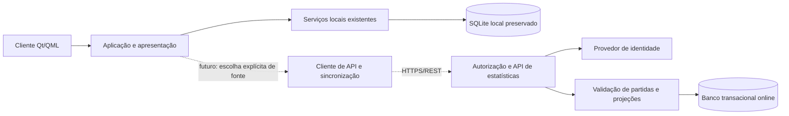

# Estatísticas multiplayer — proposta de arquitetura

**Estado: planejamento para avaliação futura.** Documento da [PR #36](https://github.com/kaduolliver/Projeto-Glossata/pull/36), com diagnóstico do código em `e02e43bf8bc8f4d2d190402edff3657cdce3524d`. A aprovação visual de Estatísticas não constitui aprovação desta arquitetura. Nenhum servidor, endpoint, conta online, migração ou envio de dados é implementado nesta PR. O roadmap principal permanece intacto.

## 1. Situação atual — funcionalidade existente

O cliente Qt/QML funciona offline. `GameController` coordena `GameService`, catálogo e o repositório SQLite concreto; a apresentação recebe propriedades e invoca comandos, sem consultar SQL no QML.

| Área | Implementação observada | Semântica |
| --- | --- | --- |
| Identidade | [`PlayerIdentity`](../../src/domain/PlayerIdentity.h), [`PlayerProfileRepository`](../../src/application/ports/PlayerProfileRepository.h), migrações e `SqliteGameHistoryRepository` | UUID local persistente, nome editável, exclusão lógica e legado sem associação presumida. A sessão captura ID/nome ao iniciar; trocar o perfil não transfere a partida. Não é uma conta autenticada na internet. |
| Armazenamento | [`SqliteGameHistoryRepository`](../../src/infrastructure/persistence/SqliteGameHistoryRepository.cpp), esquema 6 | `glossata_history.sqlite` na localização de dados da aplicação (`QStandardPaths::AppDataLocation`); caminhos explícitos isolam testes. `player_profiles`, `game_runs`, `answer_records`, `ranking_records`, `history` e `session_checkpoints` têm funções distintas. Não se deve enviar o arquivo inteiro para um serviço online. |
| Resultados | [`GameService`](../../src/application/GameService.cpp), [`GameHistoryRepository`](../../src/application/ports/GameHistoryRepository.h) | Respostas e pontos inteiros são produzidos localmente. O encerramento salva configuração, respostas detalhadas quando existentes e identidade original. A transação finaliza o checkpoint e atualiza resultados/ranking conforme a elegibilidade existente. Repetir o mesmo ID de partida não cria outra partida; conflitos de conteúdo/proprietário são recusados. |
| Rankings | `queryResults`, `upsertRanking`, [`GameConfiguration::rankingKey`](../../src/domain/GameConfiguration.h) | Melhor resultado por ID/modalidade/configuração; última partida separada. Ordem: pontos decrescentes, acertos decrescentes, data do melhor resultado crescente, nome atual com desempate e ID. `GameController::loadRanking` pede cinco posições; não existe classificação global. |
| Histórico | `playerMetrics`, `loadAnswers`, `loadPlayerResult` | Métricas pessoais percorrem respostas detalhadas disponíveis de partidas concluídas, filtradas pelo ID e chave de ranking. Resultados antigos sem detalhamento não permitem reconstrução completa. |
| Recuperação | [`SessionCheckpointRepository`](../../src/application/ports/SessionCheckpointRepository.h) e [`SessionCheckpointStorage`](../../src/infrastructure/persistence/SessionCheckpointStorage.cpp) | Snapshot versionado, hash e revisão com compare-and-swap; conserva motor/questões/alternativas/dicas e proprietário. Protege integridade/concorrência local, sem autenticar o cliente perante um servidor. |

O modo Livre usa a chave `free`, com grupos/durações variáveis. O Competitivo atual fixa 20 questões, gênero, dificuldade equilibrada, regras e impressão digital do conteúdo. A chave inclui modalidade, limite, grupo, nível, dificuldade, regras e conteúdo; `contentVersion` não deve ser confundido apenas com a versão SemVer do aplicativo. Não misturar chaves antigas ou modalidades para produzir uma comparação nova.

### Contrato disponibilizado à interface

[`GameController`](../../src/presentation/GameController.h) expõe `currentPlayerId/Name`, `sessionPlayerId/Name`, `identityNotice`, `answeredCount`, `correctAnswers`, `scoreText`, `sessionMetrics`, `playerMetrics`, `taxonomicStats`, `rankingMode`, `ranking`, `personalRecord`, contexto/configuração e recuperação. `sessionMetrics` e taxonomia pertencem à sessão; histórico/recorde pertencem ao perfil/contexto selecionados. Formatação e agregação já ficam no C++. O [diagnóstico visual](../interface/VERSOES/2.3.2/README.md) detalha os limites de interpretação.

## 2. Limitações da arquitetura local

- UUID e nome locais não provam quem controla uma conta remota. Cópias de bancos podem carregar os mesmos IDs; igualdade de nome nunca autoriza união de identidades.
- O cliente controla memória, relógio, banco, catálogo e respostas. Hashes e snapshots locais permitem verificar consistência, mas um cliente alterado pode gerar dados consistentes falsos. Embutir um segredo ou assinar com uma chave distribuída no executável não resolve esse limite.
- Não há autenticação remota, autorização entre usuários, API, base compartilhada, consentimento de publicação, fila de sincronização ou resolução entre dispositivos. O repositório concreto está construído dentro de `GameController`.
- O ranking local não tem política de temporadas/visibilidade/moderação nem comprovação competitiva no servidor. Histórico parcial e configurações heterogêneas do Livre limitam comparações.

## 3. Objetivos da expansão — ainda não implementados

Permitir contas persistentes, métricas privadas online, histórico entre dispositivos e publicação optativa de classificações globais por modalidade/configuração. Conservar o uso local sem conta ou conexão. Comparações deverão declarar população, período, configuração, cobertura dos dados e estado de validação; totais de pontos de partidas Livre de durações diferentes não se tornam comparáveis apenas por estarem online.

Nesta proposta, multiplayer significa vários jogadores compartilhando serviços de identidade/estatísticas; partidas simultâneas ou colaborativas exigiriam outro projeto de produto/protocolo. Não se presume essa funcionalidade.

## 4. Arquitetura candidata

REST/HTTPS, um provedor de identidade compatível com OAuth/OIDC e PostgreSQL são **opções a avaliar**, não tecnologias aprovadas. Um monólito modular inicial reduziria coordenação distribuída: identidade/autorização, partidas/validação e leitura de rankings separados por responsabilidade dentro do serviço. Separar serviços só se carga, operação ou limites de segurança justificarem. O cliente não acessaria PostgreSQL diretamente.

PostgreSQL é candidato por restrições de unicidade, chaves estrangeiras e transações concorrentes; isso não evita fraude por si só. A futura implementação precisaria escolher isolamento e retentativas de conflitos para finalizar resultado, elegibilidade e projeção de ranking de forma consistente. Alternativas gerenciadas relacionais podem ser comparadas por custo, operação, residência de dados, restauração e portabilidade. Referências: [restrições](https://www.postgresql.org/docs/18/ddl-constraints.html), [isolamento transacional](https://www.postgresql.org/docs/18/transaction-iso.html).

### Desacoplamento futuro, sem novas abstrações agora

As portas existentes já separam parte do domínio da persistência. Contudo, trocar `GameHistoryRepository` por uma chamada HTTP síncrona não resolveria latência, cancelamento, autenticação ou indisponibilidade e poderia bloquear a interface. Numa implementação futura, avaliar injeção do repositório local para testes e um serviço assíncrono de consulta/sincronização separado, mantendo o fluxo local autoritativo para suas próprias partidas.

Um modelo de apresentação poderia receber fonte (`local`/`online`), jogador, modalidade/configuração, cobertura e instante da consulta. As fontes podem compartilhar rótulos e componentes sem compartilhar pressupostos de confiança. Estados de carregamento, erro, dados desatualizados e vazio seriam distintos. **Local | Global** seria uma seleção futura de contexto; Livre/Competitivo continuaria sendo modalidade dentro do contexto. Não há esse seletor, botão de login ou ranking global nesta PR; a interface atual identifica **Ranking local**.

## 5. Modelo conceitual futuro

Não é DDL nem proposta de migração do SQLite. IDs são opacos e gerados/validados pelo serviço correspondente.

| Entidade proposta | Identidade/conteúdo mínimo | Restrições a avaliar |
| --- | --- | --- |
| Conta privada | `account_id`; vínculo do provedor `(issuer, subject)` | Associação autenticada única; dados de contato separados do perfil público. |
| Perfil público | `public_player_id`, apelido, visibilidade | Identificador diferente dos dados pessoais; pseudônimo não significa anonimato garantido. |
| Vínculo de dispositivo/perfil local | Conta autenticada + ID de instalação + ID local | Vínculo explícito, revogável, sem fusão por nome/UUID encontrado num backup. |
| Partida | ID do servidor ou ID de importação, proprietário, configuração, versões, origem e estado de validação | Proprietário imutável; `local_imported` não equivale a `server_verified`. |
| Evento de resposta/dica | Partida + sequência + identidade do desafio + ação | Unicidade, ordem e conteúdo conferidos; registrar resultado validado e motivo de rejeição. |
| Contexto competitivo | Modalidade, grupo, nível, dificuldade, limite, regras, impressão digital do catálogo e política de validação; temporada se aprovada | Chave explícita para comparabilidade; não apenas nome do modo ou versão do aplicativo. |
| Projeção de estatística/ranking | Jogador público + contexto + versão da projeção | Derivada de eventos elegíveis; melhor/último separados, desempate estável e consultas paginadas. |
| Operação de sincronização | Conta/dispositivo + chave idempotente + hash do payload + recibo | Mesmo conteúdo retorna recibo; mesma chave com conteúdo diferente é conflito. |
| Preferências/decisões | Visibilidade, publicação e versão do aviso/política | Escopo, momento e revogação rastreáveis, com minimização e retenção definidas. |

Nenhum desses campos é criado no banco atual. Antes de implementação, definir relações entre conta e múltiplos perfis locais, dispositivos compartilhados, propriedade e revogação; não presumir que o perfil selecionado é o proprietário de toda a atividade no dispositivo.

## 6. Segurança e integridade competitiva

### Identidade e acesso

Como proposta para o cliente nativo, avaliar autenticação no navegador do sistema com Authorization Code + PKCE, sem segredo confidencial embutido, com tokens protegidos no armazenamento seguro do sistema operacional. Validar destinatário/escopo/expiração e autorização de cada objeto no servidor; sessão autenticada não autoriza ler histórico de outro jogador. Rotação ou vinculação de refresh tokens, revogação e limites de taxa precisam de definição junto ao provedor. Bases: [RFC 8252, aplicativos nativos](https://www.rfc-editor.org/rfc/rfc8252.html) e [RFC 9700, segurança OAuth](https://www.rfc-editor.org/rfc/rfc9700.html).

### Resultados e comparabilidade

Uma API que recebe apenas `score` e `player_id` do cliente seria insuficiente. Para resultados competitivos validados, o servidor deve criar a sessão/configuração, autorizar o jogador, selecionar/registrar desafios e validar cada ação contra o conteúdo e as regras imutáveis daquela sessão. Conferir sequência, alternativas, organismo, ajuda autorizada, confirmação, limites, término e elegibilidade; recalcular pontos no servidor, recusando o total declarado pelo cliente como autoridade. Identidades do catálogo devem ser estáveis e vinculadas à sua impressão digital.

O protocolo não deve entregar antecipadamente todas as respostas corretas ou desafios futuros; o catálogo local conhecido continua impondo limites contra consulta externa, automação e colaboração. Sessões emitidas pelo servidor e pontuação recalculada elevam a confiança, mas não demonstram ausência de consulta/trapaça. Definir ameaças toleradas, validação independente e controles proporcionais antes de chamar o resultado de competitivo validado.

Preservar a representação integral dos pontos e a interpretação versionada das regras, com testes de compatibilidade entre componentes. Não recalcular históricos antigos com regras novas nem tratar arredondamento visual como unidade de armazenamento ou critério de desempate.

Persistir eventos aceitos e transicionar o resultado uma única vez, com unicidade da partida/ação, hash do conteúdo e transação. Reenvio idêntico é idempotente; reuso da chave com proprietário ou conteúdo diferente é recusado. Projeções só incluem o contexto e o nível de validação corretos, sem promover registros antigos automaticamente. Decisões de invalidação devem ser auditáveis; separar trilha competitiva da governança científica.

**Partidas locais enviadas depois não serão presumidas competitivas validadas.** A importação pode servir ao histórico privado, identificada como auto declarada/importada e sem pontuação competitiva global. Mesmo que um registro passe na validação matemática das regras, isso não comprova condições de realização, tempo ou origem. Uma futura modalidade competitiva offline exigiria política de confiança e ameaça própria, decidida antes de implementada.

## 7. Estratégia de sincronização futura

Propor adesão explícita por conta e escopo: o usuário escolhe perfis/partidas a vincular, depois de visualizar os dados enviados. Nada deve descobrir/copiar bancos pessoais em segundo plano sem essa decisão.

Uma fila durável local, introduzida apenas na etapa futura, poderia guardar operações de importação e preferências com estados pendente/enviada/confirmada/conflito. Retentativas limitadas com atraso crescente e chave idempotente evitam duplicações; queda após commit remoto é resolvida consultando/repetindo a mesma operação, não criando nova partida. O recibo do servidor e o cursor de leitura confirmados permitem continuar após desconexão.

Resultados finalizados seriam eventos imutáveis: não somar pontos duas vezes nem aceitar a regra de “última gravação vence” para proprietário, respostas ou pontuação. Duas cópias divergentes do mesmo ID local viram conflito/importações isoladas, com resolução explícita; nunca mesclar só por nome. IDs de instalação ajudam a organizar importações, sem provar identidade. Edições de apelido/visibilidade usam revisão/precondição de atualização, com política própria. Data do cliente é metadado declarado; o servidor mantém seu próprio instante de recebimento/validação.

Checkpoints atuais permanecem locais e não devem ser enviados integralmente: incluem respostas, dicas e estado do motor. Recuperação de uma sessão online, se aprovada, exigiria estado autoritativo e protocolo específico do servidor; não é simples sincronização do snapshot SQLite. Mudanças/exclusões remotas precisam de marcadores de exclusão e recibos para impedir que um backup antigo ressuscite dados apagados.

## 8. Privacidade — requisitos para avaliação

Propor histórico privado por padrão, publicação de classificação mediante escolha informada e controles de visibilidade/revogação. Separar identificador público, apelido e dados de autenticação; não expor e-mail, UUID de dispositivo, logs ou snapshots completos no ranking. Minimizar coleta e restringir acesso operacional, logs e retenção, incluindo cópias de segurança e incidentes. Não transportar fotografias/fontes científicas junto aos resultados quando bastam IDs/impressões digitais, nem presumir direitos de redistribuição online a partir da instalação local.

Antes de operar serviços, identificar responsável pelo tratamento, finalidades/bases legais por operação, público etário, territórios atendidos, operadores/transferências, direitos de acesso/correção/exclusão e períodos de retenção. Consentimento de publicação é uma proposta de produto, não uma base legal universal. No Brasil, avaliar a LGPD, incluindo alcance, princípios, direitos, segurança e tratamento de crianças/adolescentes; outras jurisdições dependem do serviço efetivamente oferecido. A definição exige análise própria, não certificada por este documento. Referência primária: [Lei 13.709/2018, texto oficial](https://www.planalto.gov.br/ccivil_03/_ato2015-2018/2018/lei/l13709.htm).

A exclusão lógica local atual não equivale a uma política de apagamento online. Definir o que pode/deve ser retido, anonimizado ou removido, a propagação a projeções/caches e como impedir reimportação indevida após exclusão. Pseudonimização não elimina obrigações sobre dados pessoais. Nesta PR, nenhum dado local é transmitido a serviços multiplayer.

## 9. Compatibilidade offline

Manter SQLite e a jogabilidade local como recursos completos, sem exigir conta ou rede. Falha/indisponibilidade online não altera sessões locais, pontuação, catálogo ou recuperação. Uma tela futura deve declarar a fonte e a atualidade do dado; não trocar silenciosamente um ranking Global indisponível pelo Local sob o mesmo título. Conteúdos de diferentes níveis de confiança/cobertura não são agregados para esconder lacunas.

O serviço online só poderia oferecer partidas validadas quando satisfizer seu próprio protocolo; desconectar não transforma o treinamento local em resultado certificado. Importações permitidas permanecem identificadas e não reescrevem históricos/snapshots locais para parecerem partidas de servidor.

## 10. Implementação incremental proposta

Esta sequência é candidata de trabalho, não alteração do roadmap ou autorização de implementação:

1. Definir público, comparabilidade, ameaças e privacidade; decidir escopos local/global e política para importações. Produzir decisões arquiteturais e critérios de aceite, incluindo recuperação de desastre e custos.
2. Experimentar serviço separado com dados sintéticos isolados, modelo transacional e testes de autorização/idempotência; avaliar tecnologias e provedor de identidade antes da escolha definitiva. Nenhum experimento entra no aplicativo ou acessa perfis reais automaticamente.
3. Integrar conta e leitura privada assíncrona de forma optativa, preservando os contratos locais. Implementar vínculo explícito, visibilidade, revogação e exportação/exclusão conforme decisões anteriores.
4. Acrescentar sincronização de histórico privado importado, com reconciliação entre dispositivos, retentativas, conflitos, registros parciais e testes de perda de rede/restauração. Não publicar esses resultados como competitivos validados.
5. Implementar protocolo de partida validada pelo servidor e projeções globais por contexto; testar cliente alterado, repetição de ações, chaves conflitantes, autorização cruzada, versões incompatíveis, concorrência e resultados incompletos.
6. Só então avaliar o seletor **Local | Global**, rankings públicos optativos e comparações coerentes. Incluir testes de indisponibilidade, limites/paginação, leitores de tela, auditoria de segurança e ensaios operacionais antes de disponibilizar o serviço.

O critério desta PR termina na interface local e neste planejamento. As decisões acima continuam abertas; nenhuma aprovação de infraestrutura, lei, licença ou curadoria é presumida.
