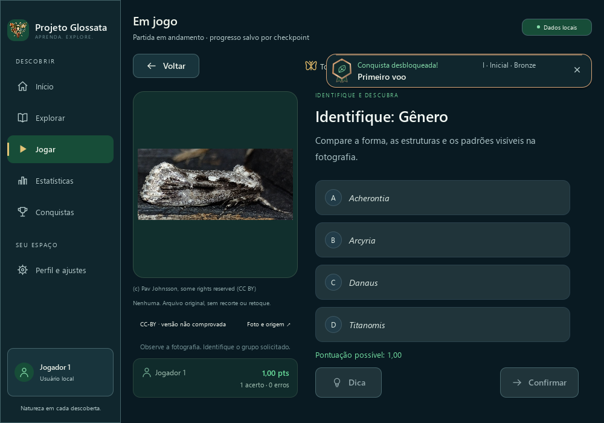

# PR #39 — notificações compactas durante o Quiz

Refinamento final da Subetapa 2.3.4 na branch `feat/achievement-notifications-2-3-4`, sobre `6cd7e7a8216b10754a1618373b84f57af44ab72e`. Aplicativo **2.2.0 ainda não lançado**, catálogo **2.4.0** e SQLite **8**, preservados. A alteração é incorporada à mesma PR, sem release, tag ou mudança de subetapa.

## Contexto e apresentação

`Main.qml` determina `compactMode` somente por `page === "quiz"`. O mesmo `AchievementNotification` recebe essa propriedade: badge de 40×44 px, padding/intervalo horizontal de 6 px e texto em duas linhas, com identificação e nível na primeira, nome na segunda. As fontes permanecem em 12/14 px; os textos quebram sem elipse e a altura vem do conteúdo. Fora do Quiz, o cartão conserva badge 64×70, margens/intervalos de 12 px, três linhas e altura mínima de 94 px.

A coluna permanece à direita, 20 px abaixo da borda real do cabeçalho e 20 px da lateral. A mudança de contexto não move o conteúdo do Quiz nem cria outra camada. Enunciado e controles essenciais são conferidos por interseção geométrica nas três resoluções e três escalas solicitadas.

## Uma fila e tempo preservado

`presentationLimit` vale um no Quiz e dois nas demais páginas. O `pump` admite novos eventos somente até esse limite. Se já há duas instâncias ao entrar no Quiz, ambas permanecem no `ListModel`; somente a primeira fica visível. A segunda recebe `presentationAllowed: false`, reutilizando a pausa existente para armazenar `remainingMs` e parar seu relógio.

Quando a primeira conclui, a segunda assume o índice zero e retoma o tempo restante; sair do Quiz também libera a segunda apresentação. Nenhuma dessas transições recoloca eventos na fila pendente, emite novamente `notificationPresented` para instâncias retidas ou recria cartões. A primeira instância permanece permitida, conservando sua entrada/leitura enquanto seu desenho muda.

As contagens têm significados diferentes: `activeCount` é o número de instâncias no modelo, inclusive uma segunda temporariamente oculta; `visibleCount` é o número permitido efetivamente visível no contexto; `pendingCount` conta eventos ainda não instanciados. Uma segunda instância oculta não é descarte. Suspensão por modal/inatividade, expiração global de 60 segundos, identidade, deduplicação, movimento reduzido e dispensa continuam no mesmo fluxo.

## Testes e método de captura

- Cenários anteriores de fila, persistência e foco/teclado no Quiz preservados.
- Novo cenário de transição nas três resoluções: mudança durante a entrada, duas instâncias/uma visível, pausa/retomada da segunda, primeiro relógio estável, novos eventos pendentes, modal, fechamento manual/automático, FIFO e expiração de instância retida.
- Matriz visual de 1000×700, 1240×820 e 1920×1080 em 100%, 125% e 150%: comparação normal/compacta, redimensionamento com a mesma instância, geometria do enunciado/controles e quatro materiais.
- Teste de quebra com título real observado e fonte ampliada em uma instância isolada do mesmo componente, fora das capturas. Verifica crescimento intrínseco e ausência de truncamento, sem inventar nomes de conquistas.

O teste visual pausa somente a leitura dos cartões enquanto grava cada PNG, chamando os métodos já existentes `pauseReading`/`startReading`; o manifesto identifica esse procedimento. Isso mantém o cartão observado durante o render/PNG em escalas altas. Os cenários de ciclo de vida, foco e transição medem o relógio normal de cinco segundos, sem essa pausa de captura. O aplicativo não recebe sinalizador, temporizador ou fila adicional para gerar as evidências.

## Resultados e comparativos

| Verificação local | Resultado |
| --- | --- |
| Suíte completa | **26/26 CTest**, zero falhas, 550,30 s |
| Interface completa | **37 casos**, zero falhas |
| Regras/controlador, identidade e recuperação | **86 / 38 / 21 casos**, zero falhas |
| Quatro cenários de notificações | Aprovados em **100%, 125% e 150%**, incluindo as três linhas de dados de transição |
| Altura observada do primeiro cartão | **94 px → 56 px** nas nove combinações, redução de cerca de 40% |
| Transição normal → Quiz | **2 instâncias/2 visíveis → 2 instâncias/1 visível**, sem descartar a segunda |
| QML, smoke, versão, metadados, licenças de código e histórico | Aprovados |

[Suíte completa](verificacoes/ctest.txt), [interface](verificacoes/ui-test-results.txt), [100%](verificacoes/ui-100.txt), [125%](verificacoes/ui-125.txt) e [150%](verificacoes/ui-150.txt). O [manifesto](capturas.json) registra datas reais, hashes, dimensões, contagens e geometria de cada cartão; distingue explicitamente visibilidade e existência no modelo.

Foram gerados **99 quadros reais** e selecionados **33**: comparativo normal/compacto e Platina nas nove combinações, mais Prata/Ouro em 1240×820 nas três escalas. Os demais originais ficam locais. As capturas não usam conquistas inventadas: o controlador confirma respostas em bancos temporários e produz os eventos persistidos. Uma nova rodada real mantém o Quiz ativo enquanto a fila de eventos ganhos na partida anterior é apresentada. O Discord permanece desativado; os saves dos jogadores não são acessados.

| Resolução lógica | 100% | 125% | 150% |
| --- | --- | --- | --- |
| 1000×700 | [Normal](capturas/100/normal-two-1000x700.png) · [Compacto](capturas/100/compact-one-1000x700.png) | [Normal](capturas/125/normal-two-1000x700.png) · [Compacto](capturas/125/compact-one-1000x700.png) | [Normal](capturas/150/normal-two-1000x700.png) · [Compacto](capturas/150/compact-one-1000x700.png) |
| 1240×820 | [Normal](capturas/100/normal-two-1240x820.png) · [Compacto](capturas/100/compact-one-1240x820.png) | [Normal](capturas/125/normal-two-1240x820.png) · [Compacto](capturas/125/compact-one-1240x820.png) | [Normal](capturas/150/normal-two-1240x820.png) · [Compacto](capturas/150/compact-one-1240x820.png) |
| 1920×1080 | [Normal](capturas/100/normal-two-1920x1080.png) · [Compacto](capturas/100/compact-one-1920x1080.png) | [Normal](capturas/125/normal-two-1920x1080.png) · [Compacto](capturas/125/compact-one-1920x1080.png) | [Normal](capturas/150/normal-two-1920x1080.png) · [Compacto](capturas/150/compact-one-1920x1080.png) |



[Prata](capturas/125/compact-level-intermediate-1240x820.png), [Ouro](capturas/125/compact-level-advanced-1240x820.png) e [Platina](capturas/150/compact-level-special-1240x820.png). A [captura oficial da Home](../../../../images/tela-inicial.png) e o [registro](../../../../images/tela-inicial.json) foram renovados pelo executável recompilado, no enquadramento inicial, e acompanham os componentes no mesmo commit.

Os [inputs da suíte completa](verificacoes/full-ctest-inputs.json) identificam o binário usado nos 37 casos. Depois dessa execução, o ajuste exclusivo do [harness de captura](verificacoes/ctest-to-capture-harness.patch) foi recompilado e os quatro cenários foram repetidos nas três escalas. O binário do aplicativo e seus fontes QML permaneceram iguais após o CTest. Os relatórios iniciais também ficam preservados: [limite contextual](verificacoes/ui-initial-100.txt), [sincronização/fonte](verificacoes/ui-second-100.txt) e [captura a 150%](verificacoes/ui-initial-150.txt).

## Reprodução

```powershell
$env:PATH='C:\msys64\ucrt64\bin;'+$env:PATH
cmake --build build/achievements-refinements --parallel 4
ctest --test-dir build/achievements-refinements --output-on-failure -j 4
$env:QT_QPA_PLATFORM='offscreen'
$env:QT_QUICK_BACKEND='software'
$env:QT_QUICK_CONTROLS_STYLE='Basic'
$env:QT_FONT_DPI='96'
$env:QT_SCALE_FACTOR='1.25' # repetir com 1 e 1.5
build/achievements-refinements/tests/glossata_ui_tests.exe achievementNotificationContextTransitions achievementNotificationVisualsAndCaptures achievementNotificationQueueAndLifecycle achievementNotificationQuizFocusAndPersistence
python scripts/capture_home.py --binary build/achievements-refinements/projeto_glossata.exe
```

## Arquivos

- Interface: `resources/qml/Main.qml`, `components/AchievementNotification.qml` e `components/AchievementNotificationLayer.qml`.
- Testes: `tests/QmlInterfaceTests.cpp`.
- Documentação: `CHANGELOG.md`, `docs/CONQUISTAS.md`, documentos atuais da interface, este registro e os apontamentos históricos da 2.3.4.
- Metadados derivados: `docs/PROJECT_STATUS.json`, atualizado pelo gerador existente após o changelog.
- Captura oficial recompilada: `docs/images/tela-inicial.png` e seu registro no mesmo commit da alteração compartilhada.
- Relatórios em UTF-8, com LF preservado por `.gitattributes`; relatórios Windows em CP1252 foram transcritos sem alterar seu conteúdo.

O [resumo estruturado](verificacoes/resultados.json) reúne os resultados e hashes; a [conferência de escopo](verificacoes/scope-and-evidence.json) registra backend, catálogo, regras, badges e `QuizView.qml` preservados em relação à base.

## Inventário sem limpeza

Varredura realizada após encerrar builds/testes: [dry-run padrão](verificacoes/cleanup-dry-run.json), [builds antigos](verificacoes/cleanup-old-builds-dry-run.json) e [inventário local](verificacoes/inventario-local.json). O script não encontrou candidatos elegíveis. Não houve exclusão, movimentação ou uso de `--apply`; a limpeza da pasta build continua adiada.

| Caminho | Bytes | Motivo | Risco |
| --- | ---: | --- | --- |
| `build/achievements-refinements` | 1956474997 | Compilação recente e evidências | Alto; preservar |
| `previews/achievement-notifications-quiz-compact` | 48571001 | Originais das capturas desta rodada | Médio; preservar rastreabilidade |
| `build/achievements-refinements/tests/previews/achievement-notifications-quiz-compact` | 12475941 | Quadros da suíte completa | Médio; preservar rastreabilidade |
| `scripts/__pycache__` | 1363308 | Cache recompilável | Baixo; somente limpeza futura autorizada |
| `tests/__pycache__` | 585884 | Cache recompilável | Baixo; somente limpeza futura autorizada |

Entradas aninhadas se sobrepõem e não devem ser somadas. Bancos, perfis, recursos, capturas e evidências anteriores foram preservados.

## Áudio e limites

O [requisito futuro de áudio configurável](../topo-direito/README.md#efeitos-sonoros--requisito-futuro) continua destinado à modernização de Perfil e ajustes. Esta etapa não adiciona sons, dependências ou configurações de áudio.

Capturas offscreen verificam os quadros renderizados e a escala Qt; não certificam fluidez física em todos os monitores ou comportamento de todos os leitores de tela. O cartão continua flutuante e pode encobrir temporariamente os rótulos de grupo/contador na faixa contextual superior do Quiz. A verificação geométrica cobre o enunciado e os botões de resposta, Voltar, Dica e Confirmar. O desenho completo permanece nas demais páginas. Evidências anteriores continuam nos registros [inicial](../README.md) e de [reposicionamento](../topo-direito/README.md).
