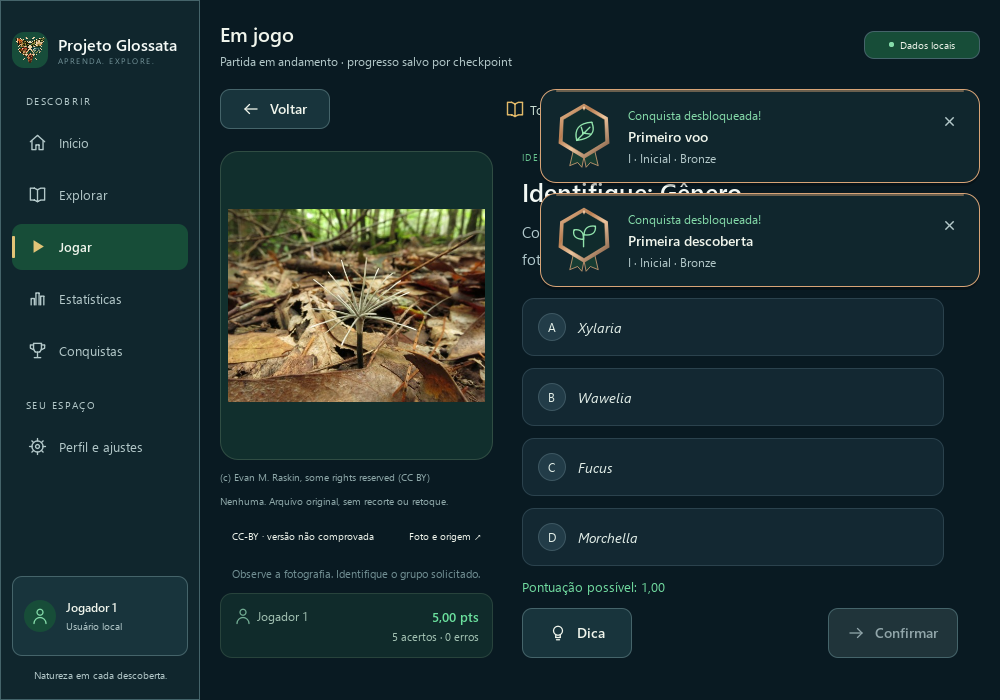

# PR #39 — notificações no canto superior direito

**Registro histórico do reposicionamento.** O [refinamento contextual atual](../quiz-compacto/README.md) limita o Quiz a uma notificação compacta e preserva até duas completas nas demais páginas. Os quadros e resultados abaixo documentam a rodada anterior; a captura oficial correspondente permanece no [commit `6cd7e7a`](https://github.com/kaduolliver/Projeto-Glossata/blob/6cd7e7a8216b10754a1618373b84f57af44ab72e/docs/images/tela-inicial.png). O requisito futuro de áudio continua válido.

Refinamento da Subetapa 2.3.4 na branch `feat/achievement-notifications-2-3-4`, sobre `f6d8f809e742f0308ea41eef996e84fd2e7f2c26`. Correção compatível incorporada ao aplicativo **2.2.0 ainda não lançado**, sem release ou tag. Catálogo **2.4.0**, SQLite **8** e as 30 conquistas preservados.

## Posicionamento e comportamento

`Main.qml` fornece `headerBottom` usando as posições reais de `mainLayout`, `pageColumn`, `sectionHeader` e a altura do cabeçalho. Essa soma coloca a borda no sistema de coordenadas da camada, que é irmã do layout principal. As dependências de posição/altura são reativas: margens, cabeçalho, navegação compacta e redimensionamento atualizam o topo, sem deslocamento vertical absoluto arbitrário.

`AchievementNotificationLayer.qml` ancora a coluna no topo, 20 px (`Theme.spaceLg`) abaixo dessa borda e 20 px à direita. A largura máxima de 440 px e o espaçamento de 10 px (`spaceSm`) permanecem iguais. A ordem do `ListModel` aparece de cima para baixo, com até duas instâncias; remover uma reorganiza a coluna e a próxima entrada FIFO ocupa o espaço livre. A camada permanece fora do Loader e da rolagem.

O cartão e o código de animações não mudam: entrada horizontal de 26 px/280 ms com fade-in, cinco segundos de leitura e saída de 200 ms com fade-out. Movimento reduzido, foco, teclado, suspensão por popups/inatividade, deduplicação e expiração permanecem no fluxo existente. Nenhum backend, checkpoint, identidade, pontuação, ranking ou catálogo foi alterado.

## Efeitos sonoros — requisito futuro

**Adicionar efeitos sonoros configuráveis às notificações de desbloqueio de conquistas**, durante a modernização de **Perfil e ajustes**.

- Reproduzir um efeito curto somente em eventos reais e confirmados de desbloqueio; nunca repetir sons de conquistas antigas ou reconstruídas ao abrir o programa.
- Oferecer opção para ativar/desativar e respeitar as preferências do usuário. Considerar volume próprio conforme a arquitetura de áudio futura.
- Não interromper outros sons do sistema; evitar volume excessivo e duração prolongada.
- Usar áudio próprio ou com licenciamento compatível e evidência de permissão quando necessária, sem presumir autoria/licença.

Este requisito é apenas documental: nenhum som, dependência de áudio ou controle de configuração foi adicionado à PR #39.

## Testes e capturas

Os três cenários existentes de notificações usam `QTemporaryDir`, controlador e QML reais, com Discord desativado. A validação geométrica agora compara cada cartão à borda do cabeçalho, ao indicador Dados locais, ao controle Retomar partida e ao cartão anterior, na ordem dos sinais de apresentação/conclusão. Confere margem superior/direita, largura preservada, espaçamento, nomes completos e limites inferiores.

O cenário visual percorre 1000×700, 1240×820 e 1920×1080, incluindo redimensionamento da mesma janela com duas instâncias ativas, passagem pelo breakpoint de navegação compacta e rolagem da Home com Retomar partida visível. Compara IDs ativos, fila pendente e a instância original para detectar reinicializações. Os cenários de ciclo de vida e Quiz continuam verificando FIFO, fechamento manual/automático, cinco segundos de leitura, movimento reduzido, modais, minimização, foco, teclas de resposta, pontuação e checkpoints.

A execução completa inicial revelou duas pendências: o hash gerado do changelog estava desatualizado e o teste legado de Explorar tentava clicar em Limpar busca após levar esse controle por foco à área ocupada pelo botão de dispensa da notificação. O [diagnóstico geométrico](verificacoes/explore-clear-geometry.json) mostra a interseção. O caso de busca agora aguarda o encerramento natural das notificações antes desse clique, mantendo o teste do controle visível; os cenários dedicados continuam exercitando o Quiz com até duas notificações ativas. Os [resultados iniciais](verificacoes/ctest-initial.txt) e o [relatório de interface inicial](verificacoes/ui-full-initial.txt) permanecem registrados. A interface de produção continua com a mudança restrita à ancoragem.

Os três cenários passaram em [100%](verificacoes/ui-100.txt), [125%](verificacoes/ui-125.txt) e [150%](verificacoes/ui-150.txt), sem falhas ou casos ignorados. Foram gerados **153 quadros reais** e selecionados **54** para versionamento: entrada, duas notificações no Quiz, suspensão por modal, Home com Retomar partida, Home rolada e Conquistas, em cada uma das nove combinações. Os demais quadros permanecem locais; as evidências anteriores não foram substituídas.

| Resolução lógica | 100% | 125% | 150% |
| --- | --- | --- | --- |
| 1000×700 | [Quiz](capturas/100/two-on-quiz-1000x700.png) | [Quiz](capturas/125/two-on-quiz-1000x700.png) | [Quiz](capturas/150/two-on-quiz-1000x700.png) |
| 1240×820 | [Quiz](capturas/100/two-on-quiz-1240x820.png) | [Quiz](capturas/125/two-on-quiz-1240x820.png) | [Quiz](capturas/150/two-on-quiz-1240x820.png) |
| 1920×1080 | [Quiz](capturas/100/two-on-quiz-1920x1080.png) | [Quiz](capturas/125/two-on-quiz-1920x1080.png) | [Quiz](capturas/150/two-on-quiz-1920x1080.png) |



[Home com Retomar partida](capturas/100/home-with-resume-1000x700.png), [Home rolada a 125%](capturas/125/scrolled-home-1240x820.png), [Conquistas a 150%](capturas/150/page-achievements-1920x1080.png), [entrada](capturas/125/entering-1240x820.png) e [modal com notificações suspensas](capturas/150/modal-suspended-1920x1080.png).

O [manifesto de capturas](capturas.json) registra datas reais, dimensões lógicas/físicas, escala e hashes dos PNGs, fontes e executáveis utilizados. A [captura oficial](../../../../images/tela-inicial.png) e seu [registro](../../../../images/tela-inicial.json) usam o enquadramento real da Descoberta do Dia (`--section discovery`), sem gerar desbloqueios artificiais, e acompanham a mudança visual no mesmo commit. Capturas offscreen verificam os quadros renderizados; não comprovam fluidez em todos os monitores ou comportamento de todos os leitores de tela.

## Reprodução

```powershell
$env:PATH='C:\msys64\ucrt64\bin;'+$env:PATH
cmake --build build/achievements-refinements --parallel 4
ctest --test-dir build/achievements-refinements --output-on-failure -j 4
$env:QT_QPA_PLATFORM='offscreen'
$env:QT_QUICK_BACKEND='software'
$env:QT_QUICK_CONTROLS_STYLE='Basic'
$env:QT_FONT_DPI='96'
$env:QT_SCALE_FACTOR='1.25' # repetir com 1 e 1.5
build/achievements-refinements/tests/glossata_ui_tests.exe achievementNotificationQueueAndLifecycle achievementNotificationQuizFocusAndPersistence achievementNotificationVisualsAndCaptures
python scripts/capture_home.py --binary build/achievements-refinements/projeto_glossata.exe --section discovery
```

## Arquivos

- Interface: `resources/qml/Main.qml`, `resources/qml/components/AchievementNotificationLayer.qml`.
- Testes: `tests/QmlInterfaceTests.cpp`.
- Documentação: `CHANGELOG.md`, `docs/CONQUISTAS.md`, `docs/interface/CHANGELOG_UI.md`, `COMPONENTES.md`, `DESIGN_SYSTEM.md`, registro da 2.3.4 e esta pasta.
- Metadados derivados: `docs/PROJECT_STATUS.json`, regenerado por `scripts/project_status.py write` para atualizar somente o hash do changelog.
- Relatórios: `.gitattributes` mantém LF nos textos desta rodada, seguindo os registros anteriores.
- Captura oficial recompilada: `docs/images/tela-inicial.png` e seu registro, no mesmo commit do shell.

As capturas anteriores continuam no [registro inicial](../README.md). Nenhum save real é usado para testes ou capturas.

## Resultados finais

| Verificação | Resultado |
| --- | --- |
| CTest | **26 grupos aprovados**: 24 na execução inicial e os dois afetados na repetição integral |
| Interface completa | **34 casos**, zero falhas na repetição |
| Regras/controlador, identidade e recuperação | **86 / 38 / 21 casos**, zero falhas |
| Notificações | Três cenários nas três escalas; matriz visual nas nove combinações |
| QML, smoke, versão, status e licenças de código | Aprovados |
| Histórico de governança | 1.053 eventos preservados; comparação com a base aprovada |

[Resumo e hashes](verificacoes/resultados.json), [reexecução CTest](verificacoes/ctest-rerun.txt), [interface final](verificacoes/ui-test-results.txt) e [conferência de escopo/evidências](verificacoes/scope-and-evidence.json). As falhas iniciais ficam registradas junto aos resultados finais. Relatórios Windows em CP1252 foram transcritos para UTF-8/LF, preservando seu conteúdo.

## Inventário sem limpeza

Varredura somente após encerrar builds e testes: [dry-run padrão](verificacoes/cleanup-dry-run.json), [builds antigos](verificacoes/cleanup-old-builds-dry-run.json) e [inventário local](verificacoes/inventario-local.json). Nenhum arquivo foi excluído ou movido; `--apply` não foi usado.

| Caminho | Bytes | Motivo | Risco |
| --- | ---: | --- | --- |
| `build/achievements-refinements` | 1941665969 | Compilação recente e originais de evidências | alto; preservar |
| `previews/achievement-notifications-top-right` | 52434733 | 153 quadros locais, incluindo originais das capturas versionadas | médio; preservar rastreabilidade |
| `build/achievements-refinements/tests/previews/achievement-notifications-top-right` | 12559882 | Quadros gerados pela suíte completa | médio; preservar rastreabilidade |
| `scripts/__pycache__` | 1363308 | Cache Python recompilável | baixo; candidato apenas a limpeza futura autorizada |
| `tests/__pycache__` | 585884 | Cache Python recompilável | baixo; candidato apenas a limpeza futura autorizada |

Entradas aninhadas se sobrepõem e não devem ser somadas. Os originais locais, builds recentes e evidências permanecem preservados. A limpeza da pasta build continua adiada.
