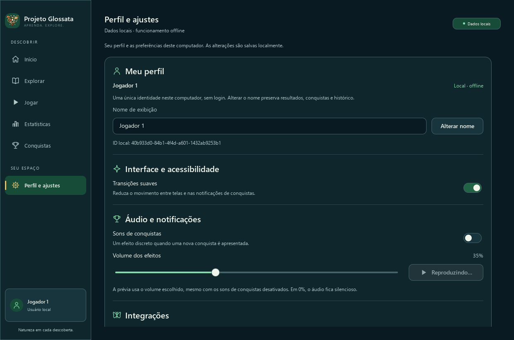

# Diagnóstico e refinamento do efeito sonoro — PR #40

Base: `a2938f5d5609b1776b6373312a810374b4b280fb`, na mesma branch e PR #40. Refinamento compatível do aplicativo **2.3.0 ainda não lançado**; catálogo **2.4.0**, SQLite **8** e pendências de distribuição/licenciamento preservados. Sem nova dependência, merge, release, tag ou Subetapa 2.4.2.

## Diagnóstico anterior à alteração

Foram examinados o gerador, `AchievementAudio`, `EffectOutput`, o WAV real, os metadados e a documentação. [WAV anterior](anterior/achievement.wav), [metadados](anterior/achievement.json), [cópia histórica do gerador](anterior/generate_achievement_sound.py) e [análise do PCM original](anterior/analise.json) preservados. A cópia do gerador é documental; para reproduzir os bytes antigos, sua função `synthesize()` pode ser importada sem executar o CLI, que contém os caminhos relativos originais.

**Hipótese A:** o arquivo de 0,85 s estava completo: cabeçalho RIFF correspondia aos 75.014 bytes, PCM mono de 16 bits/44.100 Hz, 37.485 frames, zero samples saturados e extremidades em zero. Não há evidência de truncamento técnico do arquivo. Porém, 95% da energia estava nos primeiros 343 ms e 99% até 465 ms; o RMS da janela de 0,80–0,85 s era −70,119 dBFS. O decaimento de 6,5/s é compatível com uma sensação de finalização rápida, sem demonstrar sozinho a percepção em cada equipamento.

**Hipótese B:** o callback de `audioOutputsChanged` chamava `stop()` incondicionalmente e reaplicava a saída padrão. Esse sinal representa mudanças na lista de saídas, incluindo conexão/desconexão de outras saídas; não confirma por si só que a saída efetiva mudou. [QMediaDevices](https://doc.qt.io/qt-6/qmediadevices.html). Foi identificada uma possibilidade concreta de interrupção indevida no código, mas sua ocorrência no equipamento do usuário não foi observada nem presumida.

O intervalo anterior de 1.200 ms apenas recusava pedidos, sem agendar `stop()`. `setPresentationAllowed` já ignorava atribuições sem mudança. Desativar sons, volume zero, suspensão efetiva e troca real de saída eram interrupções intencionais; elas permanecem. Alterar volume para um valor positivo não interrompe ou reinicia. O efeito é um objeto C++ persistente no shell e não é recriado a cada cartão/página. `notificationPresented`, FIFO, deduplicação, modo compacto, posição, critérios e dados não mudam.

## Síntese e comparação

Foram comparadas durações de 1,12/1,20/1,28 s e decaimentos mais lentos. A escolha de **1,20 s com 3,2/s** mantém o pico e amplia o corpo, em vez de apenas acrescentar uma cauda quase silenciosa. As três fundamentais são mantidas, com ataque por seno ao quadrado, uma sustentação de 40 ms e harmônicos exatos discretos. A finalização global também usa seno ao quadrado, com extremos suaves. Não há samples externos ou silêncio anexado.

| Medida | Anterior | Atual |
| --- | ---: | ---: |
| Duração | 0,85 s | 1,20 s |
| Frames / bytes | 37.485 / 75.014 | 52.920 / 105.884 |
| Ataque / sustentação | 18 ms / sem patamar | 24 ms / 40 ms |
| Decaimento exponencial | 6,5/s | 3,2/s após ataque/patamar |
| Finalização global | 160 ms | 300 ms |
| Entradas das notas | 0, 95, 190 ms | 0, 110, 220 ms |
| Pico | −8,874 dBFS | −8,874 dBFS |
| RMS integral | −21,150 dBFS | −21,531 dBFS |
| Energia acumulada de 95% | 342,653 ms | 584,989 ms |
| Energia acumulada de 99% | 465,193 ms | 798,231 ms |
| Samples saturados | 0 | 0 |
| Primeiro / último sample | 0 / 0 | 0 / 0 |
| Maior diferença entre samples normalizados | 0,045197 | 0,049194 |
| Zeros consecutivos ao final | 5,782 ms | 6,825 ms |

[Comparação e métodos](comparacao.json), [medidas atuais em janelas de 50 ms](analise-depois.json). As amplitudes DTFT integrais das fundamentais (523,251 / 659,255 / 880 Hz) mudaram de −25,376 / −28,284 / −29,969 dBFS para −24,741 / −27,042 / −28,570 dBFS. São medidas digitais do arquivo inteiro, não LUFS, intensidade física ou certificado de audibilidade. O critério relativo de RMS em janelas de 20 ms ainda encontra atividade até 1,12 s; os últimos 6,825 ms quantizados em zero não constituem padding prolongado.

SHA-256 anterior: `dc62f483eb235b58ae59edf0e3a89f99e1cc6203a3a1ca58e2e9abf0a50b1e21`. Atual: `08c32793a11ffbe38147d733ea62f0d9a97df2a987973070ed7e5becdffbea80`. O JSON do recurso registra todos os parâmetros da revisão 2. `python scripts/generate_achievement_sound.py --check` confere bytes/metadados; `python tests/test_achievement_sound.py` executa as verificações independentes, apenas com a biblioteca padrão.

## Reprodução e prévia

`EffectOutput` só reaplica uma saída quando o ID efetivo da saída padrão muda. Atualizações da lista com o mesmo ID não chamam `stop()` nem reiniciam o recurso. Interrupções só chegam a `stop()` se houver reprodução ativa; o motivo fica registrado antes do evento de parada do Qt. Os mesmos métodos de guarda são exercitados por uma saída simulada, sem construir dispositivo físico.

O intervalo mínimo passa a **1.300 ms**: duração de 1,20 s mais guarda de 100 ms. Mesmo depois desse intervalo, `playing()` impede reiniciar um som ativo. A prévia informa “Reproduzindo…” e “Aguarde…”, fica indisponível quando não pode tocar e usa largura constante para conservar o alinhamento. Um timer preciso notifica o fim da espera; não é usado para cortar o áudio. Não há fila sonora adiada. A prévia continua explícita, permitida com sons automáticos desativados, no volume escolhido.

O Qt continua carregando o PCM local em um único [QSoundEffect](https://doc.qt.io/qt-6/qsoundeffect.html). O ID da saída é consultado novamente nos eventos de dispositivos, usando a instância atual de [QAudioDevice](https://doc.qt.io/qt-6/qaudiodevice.html). Mudanças internas do driver e latência física exigem observação manual; os testes não afirmam validá-las.

## Validação auditiva manual no Windows

1. Recompile com `cmake --build build -j 4`. Use os arquivos deste checkout e o executável recém-compilado, não um pacote anterior. Escolha um volume confortável no Windows. Para comparar o ganho do WAV externo com o aplicativo, use temporariamente 100% de efeitos apenas no modo isolado; depois avalie também o padrão de 35%.
2. Ouça os dois WAVs fora do Qt/aplicativo, pelo Windows, mantendo a mesma saída física:

```powershell
foreach ($audioPath in @(
    'docs/interface/VERSOES/2.4.1/refinamento-audio/anterior/achievement.wav',
    'resources/audio/achievement.wav'
)) {
    $audioPlayer = New-Object System.Media.SoundPlayer ([IO.Path]::GetFullPath($audioPath))
    try { $audioPlayer.PlaySync() } finally { $audioPlayer.Dispose() }
}
```

3. Abra o modo manual do **executável de testes**, que usa o QML/controlador e a saída QSoundEffect de produção, com bancos/preferências temporários e sem iniciar Discord. O título identifica os dados temporários. O modo não é acionado pelo CTest e não altera a abertura normal do Glossata. Na raiz do projeto:

```powershell
$audioManualDir = Join-Path (Get-Location) ('build/audio-manual-' + [guid]::NewGuid().ToString('N').Substring(0,8))
New-Item -ItemType Directory -Path $audioManualDir | Out-Null
$previousAudioQpa = $env:QT_QPA_PLATFORM
$previousAudioStderr = $env:QT_FORCE_STDERR_LOGGING
try {
    $env:QT_QPA_PLATFORM = 'windows'
    $env:QT_FORCE_STDERR_LOGGING = '1'
    Start-Process -FilePath (Resolve-Path 'build/profile-settings-2-4-1/glossata_ui_tests.exe') `
        -ArgumentList '--manual-audio' -WorkingDirectory (Get-Location) -WindowStyle Normal -Wait `
        -RedirectStandardOutput (Join-Path $audioManualDir 'stdout.log') `
        -RedirectStandardError (Join-Path $audioManualDir 'stderr.log')
} finally {
    $env:QT_QPA_PLATFORM = $previousAudioQpa
    $env:QT_FORCE_STDERR_LOGGING = $previousAudioStderr
}
Get-Content -LiteralPath (Join-Path $audioManualDir 'stderr.log')
```

4. Use Testar som e mantenha a janela ativa até o fim. Cliques rápidos devem ficar bloqueados sem reiniciar o som. Ao completar, o botão volta a ficar disponível. Navegar de página por si só não solicita parada; minimização, perda de atividade e modais continuam sujeitos à suspensão existente.
5. Ative sons de conquistas e jogue até desbloquear uma conquista real nesse banco temporário. Confirme o mesmo efeito, sem áudio ao abrir Conquistas nem repetição ao reapresentar um cartão. Não há geração artificial de eventos no modo manual.
6. Provoque separadamente as interrupções intencionais: volume zero, desativação de sons, suspensão e mudança real da saída padrão. Uma mudança de lista sem mudar o padrão não deve gerar parada explícita. Reativar ou reconectar não deve repetir o som anterior automaticamente.
7. Compare a audição com o log. `GLOSSATA_AUDIO_TRACE=1` é ativado no modo manual (opcional na execução normal). Ele registra tempo monotônico em ms, pedidos e motivos, sem nomes/UUIDs pessoais:

| Registro | Interpretação |
| --- | --- |
| `requested=preview` ou `requested=<id da conquista>` | Pedido ao backend, com volume configurado; não comprova emissão física |
| `stop-requested=sounds-disabled` | Interrupção por desativação |
| `stop-requested=volume-zero` | Interrupção por silêncio solicitado |
| `stop-requested=presentation-suspended` | A guarda existente suspendeu a apresentação |
| `stop-requested=device-changed` | O ID efetivo da saída padrão mudou |
| `ended=finished` sem pedido de parada | Qt deixou de informar reprodução, com saída pronta e sem `stop()` próprio pendente |
| `ended=output-unavailable` | Fim observado com saída não pronta, sem parada própria pendente |

Se o defeito estiver no WAV externo, concentre a revisão na síntese/arquivo. Se ocorrer somente no caminho Qt com `stop-requested`, o motivo identifica a interrupção do aplicativo. Se o WAV externo estiver normal e o Qt reportar fim sem parada explícita, registre versão Qt/Windows, saída/driver, ganho e tempos observados para investigar backend/bufferização; o log não certifica que o hardware reproduziu todos os samples. Não renomeie/apague bancos pessoais para testar. Ao fechar o modo manual, somente seus diretórios temporários são descartados; logs em build ficam preservados.

## Testes, rastreabilidade e limites

[Resultados, comandos e hashes](../verificacoes/audio-resultados.json). A suíte **CTest completa passou 28/28 grupos, sem falhas, em 687,41 s**. São **28 casos de preferências/áudio**, **46 na interface completa**, **86 de regras/controlador**, **38 de identidade** e **21 de recuperação**. A seleção inicial da interface afetada passou 11 casos; o teste de PCM passou **7 casos**, incluindo reprodução determinística dos bytes/metadados/hash, formato/cabeçalho, clipping, continuidade, extremidades, frequências e corpo/finalização sem padding.

Os testes com saída simulada cobrem término natural sem `stop()`, interrupções explícitas por preferência/volume/suspensão, atualizações repetidas com o mesmo ID, troca efetiva, ausência/reconexão de saída, volume positivo sem reinício, proteção contra cliques consecutivos e notificação do fim do intervalo. A integração QML exercita o botão por teclado, seus estados/largura, desbloqueio real no controlador temporário, deduplicação, suspensão e ausência de áudio retroativo. FIFO, modo compacto e regressões anteriores continuam na suíte inteira.

O [trace simulado](../verificacoes/audio-trace-simulado.txt) aprovou 7 casos, inclusive inicialização/finalização; seus tempos de 0–3 ms representam eventos simulados, não a duração física do áudio. O [smoke do modo manual](../verificacoes/audio-manual-smoke.json) passou apenas pela abertura/fechamento do caminho QSoundEffect real, com sons automáticos desativados e sem disparar reprodução. Nenhum teste automatizado exige dispositivo físico.

A [captura real](preview-playing.png), com [manifesto e hashes](captura.json), registra o botão ocupado em 1240×820 a 100%, usando QML/controlador reais e saída simulada. Após a suíte inteira, foi acrescentada somente uma espera de 150 ms no teste, antes da captura, para concluir a transição de entrada já existente. O teste foi recompilado e o caso afetado passou novamente: [3 casos incluindo inicialização/finalização](../verificacoes/audio-preview-final.txt). As fontes do produto não mudaram após a suíte completa; os [hashes da execução completa](../verificacoes/audio-full-run-inputs.json) distinguem o executável de testes anterior. A primeira repetição isolada omitiu o ambiente Basic/offscreen do CTest e falhou por avisos de customização do estilo nativo; [log preservado](../verificacoes/audio-preview-estilo-incorreto.txt). O mesmo binário passou com o ambiente correto, sem correção adicional do produto.



Lint QML completo, verificação do gerador, inventário de código, release check e project status passaram. A [auditoria de governança](../verificacoes/audio-governanca.json) preserva os **1.053 eventos** e baseline em relação à base desta correção. O gate de distribuição continua **bloqueado, código 2**, sem contorno ou revisão de direitos inferida. Os [arquivos modificados](../verificacoes/audio-arquivos-modificados.txt) identificam somente este refinamento, separado dos registros históricos da PR.

A audição física no Windows ainda não foi realizada pelo agente; qualidade percebida, driver, Bluetooth, latência e comportamento dos dispositivos permanecem sujeitos ao procedimento manual. A guarda compara o ID efetivo da saída padrão e não certifica todas as mutações internas de driver/formato com o mesmo ID.

## Inventário não destrutivo

Executado `python scripts/cleanup_build.py` em modo padrão **dry-run**, após os testes/builds: **zero candidatos elegíveis**, sem exclusões. [Plano](../verificacoes/audio-cleanup-dry-run.json) e [inventário adicional](../verificacoes/audio-inventario.json) preservados.

| Caminho local | Bytes | Motivo / risco |
| --- | ---: | --- |
| `build/profile-settings-2-4-1` | 323.918.990 | Build ativo da PR; risco alto, preservar |
| `previews/audio-refinement` | 74.533 | Original da captura versionada; revisar rastreabilidade antes de qualquer remoção futura |
| `build/tests/previews/audio-refinement` | 71.819 | Captura da suíte completa durante a entrada; preservar evidência |
| `scripts/__pycache__` | 1.378.071 | Cache regenerável; risco baixo após testes, sem autorização para excluir |
| `tests/__pycache__` | 585.884 | Cache regenerável; risco baixo após testes, sem autorização para excluir |
| `build/audio-refinement-*` e helper de registro | 29.430 | Relatórios locais e proveniência; preservar para revisão |

Não há novos samples externos ou concessões de direitos. A licença do WAV e a inclusão expressa de código novo continuam pendentes; o teste Python novo foi registrado como pendente no inventário, sem alterar decisões anteriores. Não foram modificados catálogo científico, fotografias, dados pessoais, SQLite, identidade, pontuação, critérios, fila visual, badges, animações, Discord ou a correção de persistência. A documentação e os arquivos anteriores permanecem preservados.
